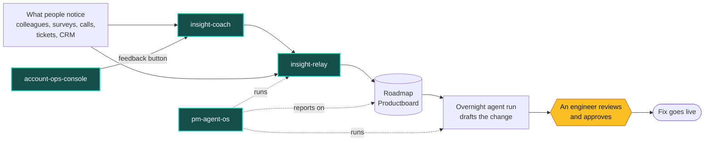

  

  <a href="account-ops-console/">account-ops-console</a> ·
  <a href="insight-coach/">insight-coach</a> ·
  <a href="insight-relay/">insight-relay</a> ·
  <a href="pm-agent-os/">pm-agent-os</a> ·
  <a href="product-case-studies/">case studies</a>

A working collection of things I've built and shipped as a hands-on product manager, added to as I go. The tools come from a UK hospitality commerce company serving luxury hotels and spas; the case studies also draw on a restaurant ordering and payments platform before it. The originals and their code belong to those companies. Everything here is my own write-up, and people appear by role only.

## What I've built

| | Tool | What it is | Read |
|---|---|---|---|
| 💳 | [**account-ops-console**](account-ops-console/) | An incident tool for creating Stripe accounts that grew into the operations team's console for every merchant payment account. | [Architecture](account-ops-console/docs/architecture.md) · [Decisions](account-ops-console/docs/decisions/) · [Build log](account-ops-console/BUILD-LOG.md) |
| 💬 | [**insight-coach**](insight-coach/) | A two-to-three question chat that turns "something I noticed" into an evidenced product insight. | [Architecture](insight-coach/docs/architecture.md) · [Decisions](insight-coach/docs/decisions/) · [Build log](insight-coach/BUILD-LOG.md) |
| 🔀 | [**insight-relay**](insight-relay/) | One intake for about ten feedback sources, with an AI judge and a trial run before any automated lane files to the roadmap. | [Architecture](insight-relay/docs/architecture.md) · [Decisions](insight-relay/docs/decisions/) · [Build log](insight-relay/BUILD-LOG.md) |
| 🧭 | [**pm-agent-os**](pm-agent-os/) | My own AI workspace for day-to-day product work: agents that read, draft and keep the record, with every outgoing message held for my approval. | [Architecture](pm-agent-os/docs/architecture.md) · [Decisions](pm-agent-os/docs/decisions/) · [Build log](pm-agent-os/BUILD-LOG.md) |

Each write-up follows the same shape: **problem → who it was for → what it does → decisions → build log → what I'd do differently.** The build logs are written up from dated decision records and include the reversals. New builds are added as they ship.

## Product case studies

Each study runs problem, solution and impact: how I found the problem, how I chose the fix, and what it measurably changed.

- [**Retuning fraud rules that were turning away good guests**](product-case-studies/fraud-rules-blocking-good-guests/): a reversible call made live when no quick test could prove it safe, measured against triggers agreed in advance.

More studies on prioritisation, payments and integrations are being added.

## How some of them connect

The tools stand alone, and a few feed one another: the console's feedback button opens the coach, the coach files through the relay, and the relay feeds the roadmap.

## Reading notes

- Case studies give elapsed time ("at six weeks") rather than calendar dates.
- Diagrams are Mermaid and render on GitHub.
- Stripe, Productboard, Claude Code and Vercel are named because the work is specific to them. Other vendors are described generically.
- Docs only: the code stayed with the employers.
