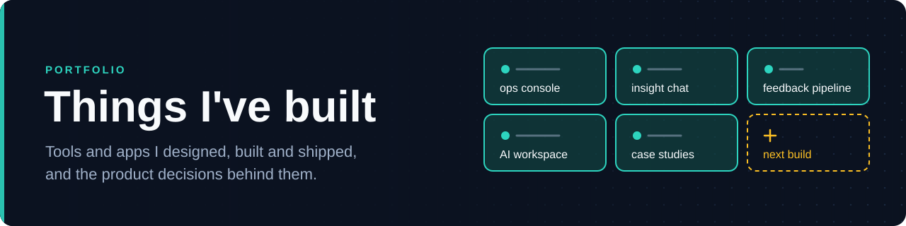

  

  <a href="account-ops-console/">account-ops-console</a> ·
  <a href="insight-coach/">insight-coach</a> ·
  <a href="insight-relay/">insight-relay</a> ·
  <a href="pm-agent-os/">pm-agent-os</a> ·
  <a href="https://github.com/sirk-code87/simphony-sts-harness">simphony-sts-harness</a> ·
  <a href="product-case-studies/">case studies</a>

A working collection of things I've built and shipped as a hands-on product manager, added to as I go. The tools come from a UK hospitality commerce company serving luxury hotels and spas; the case studies also draw on a restaurant ordering and payments platform before it. The originals and their code belong to those companies. Everything here is my own write-up, and people appear by role only.

## What I've built

| | Tool | What it is | Read |
|---|---|---|---|
| 💳 | [**account-ops-console**](account-ops-console/) | An incident tool for creating Stripe accounts that grew into the operations team's console for every merchant payment account. | [Architecture](account-ops-console/docs/architecture.md) · [Decisions](account-ops-console/docs/decisions/) · [Build log](account-ops-console/BUILD-LOG.md) |
| 💬 | [**insight-coach**](insight-coach/) | A two-to-three question chat that turns "something I noticed" into an evidenced product insight. | [Architecture](insight-coach/docs/architecture.md) · [Decisions](insight-coach/docs/decisions/) · [Build log](insight-coach/BUILD-LOG.md) |
| 🔀 | [**insight-relay**](insight-relay/) | One intake for about ten feedback sources, with an AI judge and a trial run before any automated lane files to the roadmap. | [Architecture](insight-relay/docs/architecture.md) · [Decisions](insight-relay/docs/decisions/) · [Build log](insight-relay/BUILD-LOG.md) |
| 🧭 | [**pm-agent-os**](pm-agent-os/) | My own AI workspace for day-to-day product work: agents that read, draft and keep the record, with every outgoing message held for my approval. | [Architecture](pm-agent-os/docs/architecture.md) · [Decisions](pm-agent-os/docs/decisions/) · [Build log](pm-agent-os/BUILD-LOG.md) |
| 🗺️ | [**ai-product-blueprint**](ai-product-blueprint/) | The reusable design behind pm-agent-os, for any AI agent: which tool owns which fact, the playbook from signal to spec, a draft-only agent team, and Obsidian as knowledge base and task system. | [Playbook](ai-product-blueprint/docs/product-playbook.md) · [Workflow](ai-product-blueprint/docs/workflow.md) · [Agent team](ai-product-blueprint/docs/agent-team.md) |

Each tool write-up follows the same shape: **problem → who it was for → what it does → decisions → build log → what I'd do differently.** The build logs are written up from dated decision records and include the reversals. The blueprint is a design document and covers the four parts of the system instead. New builds are added as they ship.

## Open-source tools

My own projects, with the code in their own repos.

| | Tool | What it is |
|---|---|---|
| 🧾 | [**simphony-sts-harness**](https://github.com/sirk-code87/simphony-sts-harness) | A local GUI for testing the Oracle Simphony Transaction Services Gen 2 API, from login to a paid check, with a built-in mock server so it runs without credentials. |

## Product case studies

Each study runs problem, solution and impact: how I found the problem, how I chose the fix, and what it measurably changed.

- [**Retuning fraud rules that were turning away good guests**](product-case-studies/fraud-rules-blocking-good-guests/): a fraud rule was declining genuine guests, some of them eight times on one booking. No quick test could prove a change safe, so I narrowed the rule live, wrote down when I'd reverse it before any results came in, and cut its blocks by 95% with no rise in fraud warnings.
- [**An upsell engine operators would trust with their margins**](product-case-studies/upsell-engine/): restaurant operators lost a working day or more every menu cycle building upsell lists by hand. I chose a machine learning engine that learned from real orders, and when the pilot showed operators wouldn't trust a black box, the second release gave them an audit trail and their own rules. Average transaction value rose 8% to 12% against control groups.
- [**An integration hub that products would choose to use**](product-case-studies/integration-hub/): a software group sold one connected suite, but each acquired product ran its own integrations. I designed a shared hub where products keep their own swap-in connectors, named adoption as the real risk, and proved the architecture on a low-risk reservations use case before anything was sold on it.

More studies on prioritisation and payments are being added.

## How some of them connect

The tools stand alone, and a few feed one another: the console's feedback button opens the coach, the coach files through the relay, and the relay feeds the roadmap.

## Reading notes

- Case studies give elapsed time ("at six weeks") rather than calendar dates.
- Diagrams are Mermaid and render on GitHub.
- Stripe, Productboard, Claude Code and Vercel are named because the work is specific to them. Other vendors are described generically.
- Employer tools are docs only: that code stayed with the employers. Open-source tools link to their own repos.
