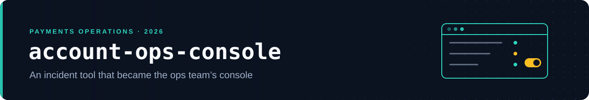
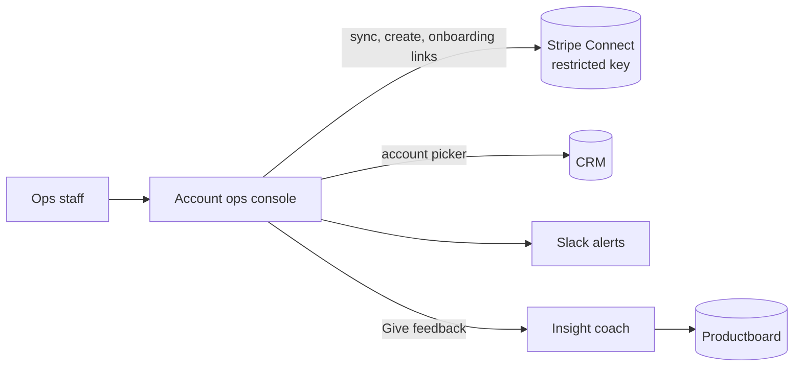

  

  <a href="../README.md">← Portfolio</a> ·
  <a href="docs/architecture.md">Architecture</a> ·
  <a href="docs/decisions/">Decisions</a> ·
  <a href="BUILD-LOG.md">Build log</a>

| My role | When | Built with | Status |
|---|---|---|---|
| Specced, built with Claude Code agents, owned | Sep to Nov 2026 | Stripe Connect, restricted keys, audit log | Kept permanently, Nov 2026 |

An operations console for the Stripe accounts behind a payments product. It began as an incident tool for creating Stripe connected accounts (the Stripe account each hotel or spa needs to take payments through the company's platform) and grew over about five weeks into the console staff used to manage all of them. I specced it, built it with Claude Code agents (AI coding assistants) and owned it as the product lead at a UK hospitality commerce company (luxury hotels and spas) in late 2026.

The system belongs to that company. Everything here is written fresh for this repository, with invented names and invented data.

## The problem

In late September 2026 the implementations team, who set up new hotel and spa properties, could no longer create their Stripe accounts through the Stripe Dashboard. Each attempt returned an error, but Stripe had created the account anyway, so every retry left an extra, orphaned account.

I traced the error to a different call. The create succeeded; the failure was in the follow-up list call that looked for the new account. Small list requests worked and larger ones failed. Stripe uses an idempotency key (a tag that marks two requests as the same request) to prevent duplicates. Retrying with the same key replayed the stored error, and a new key made a second account.

That diagnosis set the tool's shape: create once, never retry automatically, find the account with a small list call, and stop for a person to check if the account cannot be confirmed.

## Who it was for

- The implementations team, who set up new properties.
- Support and payments staff, who chased properties about verification deadlines and disputes, and needed a reliable map from property to Stripe account.
- The CRM owners, since every Stripe account needed to tie back to a CRM account.

## What it does

| Area | What staff get |
|---|---|
| Account creation | A guarded create flow that moves through fixed steps (a state machine), a stable signed onboarding link for the property, and an "unconfirmed" stop when Stripe's response is ambiguous |
| Account registry | Several hundred connected accounts synced from Stripe every few minutes, sorted by account type and current state, with links to properties |
| Verification queue | Accounts ranked by deadline and state, with a chase log recording each chase and when to chase next |
| Dispute risk | Disputes (customers challenging a payment), early fraud warnings and reviews per account, linked to the original order, with alerts framed around whether the property has responded |
| CRM account picker | Staff pick the CRM account, or skip with a logged reason, when creating a property |
| Direct links | Dispute, payment and payout IDs open straight in the Stripe Dashboard |
| Feedback | A "Give feedback" button opens the insight coach, a short guided chat, so requests reach the roadmap with the rest of the company's feedback |

More diagrams in [docs/architecture.md](docs/architecture.md).

## How I ran it as a product

The console is small. The method around it is the part worth reading, in [docs/product-method.md](docs/product-method.md):

- **Ranked opportunities with a stated formula.** Research across support tickets, Slack and call transcripts produced 13 opportunities, scored as Reach × Impact × Confidence × Strategic multiplier ÷ Effort and labelled as judgement. The verification queue ranked first; changes made in Stripe ranked last.
- **Read-only features first.** Six slices (small features shipped one at a time) that only read data went out before any new change to Stripe.
- **Six write options, one chosen.** I picked an onboarding update link for existing accounts because it could do the least harm if misused and reused existing controls. The other five went on an explicit Not Doing list with reasons.
- **Hypotheses with measures**, each with a line saying what I would do if it proved wrong.
- **A dated review** to keep, widen or retire the tool.
- **A threat model and a privacy pack.** The threat model lists what could go wrong and the control for each risk, using STRIDE, a standard checklist of six threat types. A generic version is in [docs/threat-model.md](docs/threat-model.md).

## Safeguards

- **An audit log that fails closed.** Every action writes a record of the attempt in the same database step as the change, before anything is sent to Stripe. If that record cannot be written, the action stops. The table accepts new rows only.
- **A live switch only I could arm.** Live creates and onboarding links required it; any admin could turn it off.
- **One narrow restricted Stripe key.** The key held named permissions only: account and account-link access plus the specific reads the risk queue needed. Charges read (access to Stripe's record of each card payment) stayed off it, because charges carry cardholder data and the console needed none of it.
- **Only the needed data comes in.** Each Stripe record is mapped to a small internal shape holding the fields the console uses, and every other field is dropped at the point of entry.

Decisions are recorded as ADRs (architecture decision records: short notes of each decision, the options and the reasons) in [docs/decisions/](docs/decisions/).

## Outcomes

**Measured:**

- **Built fast.** The incident tool went from spec to merged, reviewed slices in a day. The six read slices followed within the same week.
- **Live registry.** Several hundred connected accounts synced live with types and states, and the registry surfaced accounts that had never finished onboarding for a clean-up review.
- **One live property.** Stripe fixed the list call shortly before I armed the live switch, so the incident ended before the tool mattered for it. One live property was created through the console before the keep decision.

**Not yet measured:**

- **Usage.** The implementations team used the console, and users in two teams gave positive feedback. That evidence is qualitative; usage was never counted.
- **The hypotheses.** I did not run the baseline report, and the chosen write feature stayed switched off because I did not secure the risk-acceptance sign-off it required.
- **The keep decision.** I kept the console permanently on the strength of account creation, on my own assessment and without usage figures. The create count does not support that reason.

What it demonstrates is the read model (registry, verification queue, disputes linked to orders and properties) and the governance around it. What would settle its value: a measured cut in missed deadlines.

## What I'd do differently

- **Alerting before go-live.** I launched with alerts routed through the app's own database and no external uptime checks or error monitoring. When the database became unavailable, the console went down silently. I would wire independent monitoring on day one and size the database for production from the first live key.
- **Hold my own security review.** I waived the pre-live security review I had set, reasoning that the key was read-only. The reasoning held, but the gate existed to give the decision a second judge. I also merged a change while skipping the browser test and second review I had asked for.
- **Separate development and production from the start.** I let development and production (the live system) share a database, so a local development server could touch live data.
- **Measure before the next slice.** My own agent reviewers said the tool had more built than proven. I would run the baseline queries before building further, and make the keep decision wait for a usage count.
- **Test on the production database engine.** The lightweight test database accepted query formats the live database rejected, so some bugs passed the tests and reached live.

## About this repository

This repository documents the design: architecture, decisions, build history and lessons. The original system and its code are private.

## Repo contents

- [BUILD-LOG.md](BUILD-LOG.md): build history, reconstructed to the month
- [docs/architecture.md](docs/architecture.md): context, data model, create flow, sync and alerts
- [docs/product-method.md](docs/product-method.md): ranking, slices, Not Doing, hypotheses, the review gate
- [docs/threat-model.md](docs/threat-model.md): generic STRIDE threat model and privacy approach
- [docs/decisions/](docs/decisions/): decision records
