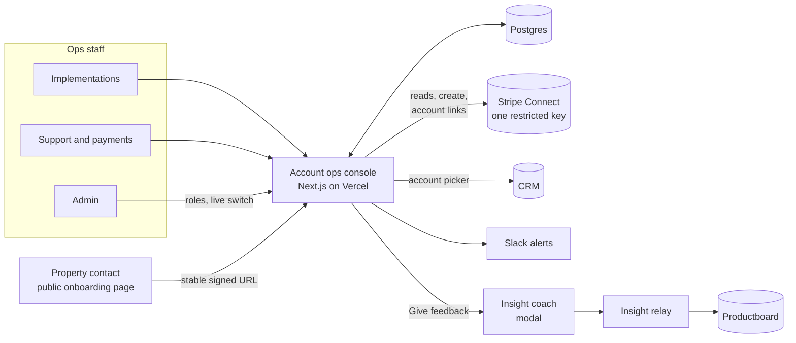
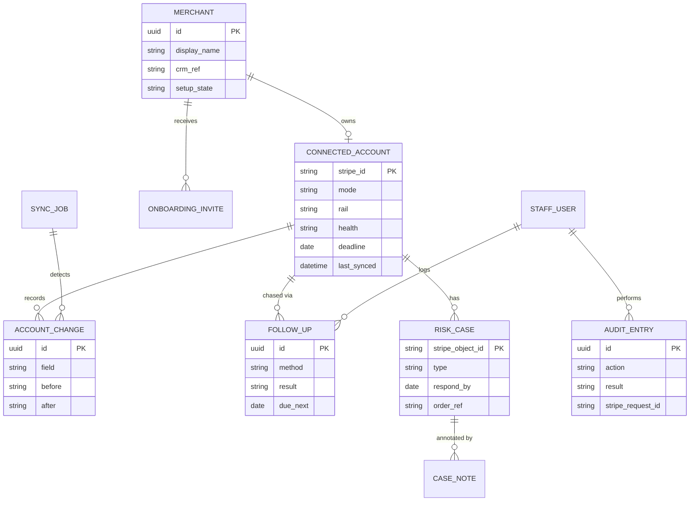
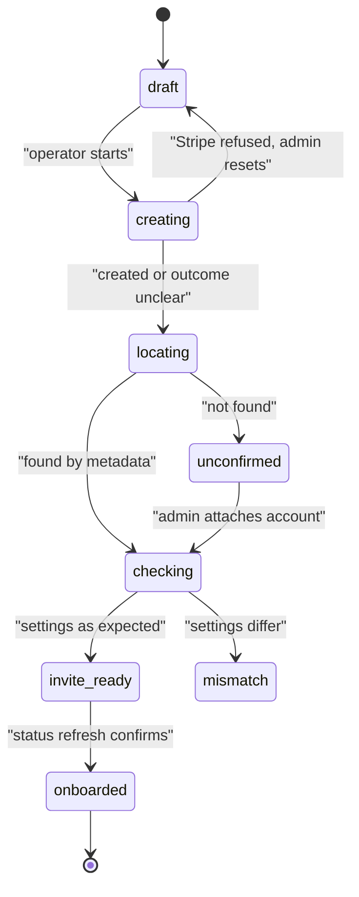
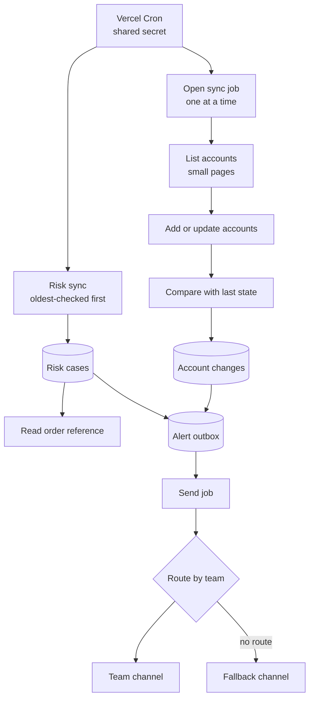

# Architecture

A standalone web app (built with Next.js, hosted on Vercel) with a Postgres database. Sign-in is limited to the company domain and an invite list, and the app holds one restricted Stripe key, limited to named permissions. Business rules sit in a single onboarding service. All Stripe traffic goes through narrow gateway ports: small interfaces that each expose only the calls a feature needs. Each port has a live version and a fake one, so unit tests run against the fakes and contract tests (checks that the real calls still behave as expected) run against Stripe's sandbox, its test environment.

Roles are viewer, operator and admin, read from the database on every request. Amounts are hidden on the server for every user except those an admin has granted permission to see them.

The data model below is designed fresh for this write-up to show the shape of the idea.

## 1. Context

Staff work in the console, and the console alone holds the Stripe key. The property contact uses a link with no sign-in. They open a stable signed URL (a fixed link carrying a tamper-proof token), confirm they asked for the account, and are redirected to a newly created Stripe onboarding link. Almost all Stripe traffic reads data; the console writes to Stripe for two things: account creation and onboarding links. Staff feedback goes through the insight coach, a short coached chat, and reaches Productboard through the insight relay.

## 2. Data model

A merchant is the business being set up; it holds at most one connected account. Every row that comes from Stripe carries a `mode` (test or live), which keeps sandbox and live data apart. The history tables (account changes, follow-ups, case notes, audit entries) are append-only: the app's database login can add and read rows, and that is all. The audit table holds loose references to other rows, with no enforced links, so it can record an attempt against something that was never created. An account's `rail` (which of the two account setups it uses) is worked out from its controller settings, because Stripe's top-level account type can show the same value for accounts configured differently.

## 3. Account-creation flow

A create starts only from a draft merchant. The console claims the merchant in a single database step, so two operators cannot start the same create at once. The create call is never retried automatically. Any server error, timeout or rate-limit response counts as "outcome unclear", and only a definite refusal lets an admin reset to draft. The locate step lists a handful of recent accounts a few times, with a growing pause between tries (backoff), matching on metadata the create set. If the account still cannot be found, the merchant goes to `unconfirmed` and creates stay blocked until an admin attaches the right account by hand. The check step compares the account's configuration with what the platform expects. A clean-up job moves anything stuck in a working state to `unconfirmed`. Onboarding counts as complete only when Stripe reports the account fully enabled with nothing due.

## 4. Sync and alert pipeline

Vercel Cron, the hosting platform's scheduler, calls each job with a shared secret. The account sync opens a job row (the database allows one open job at a time), pages through Stripe's account list in small pages, adds or updates each account and records each change. The risk sync works through accounts in order of when they were last checked, so the whole set of accounts is covered within Stripe's request limits. For each dispute it reads only the order reference needed to link back to the booking. Alerts go into an outbox, a table of messages waiting to send, and a send job posts them to Slack, routed per team with a fallback channel so every alert reaches someone. The weakness of this design is that the outbox lives in the app's own database: if the database is down, so are the alerts. An independent uptime check belongs outside it.
