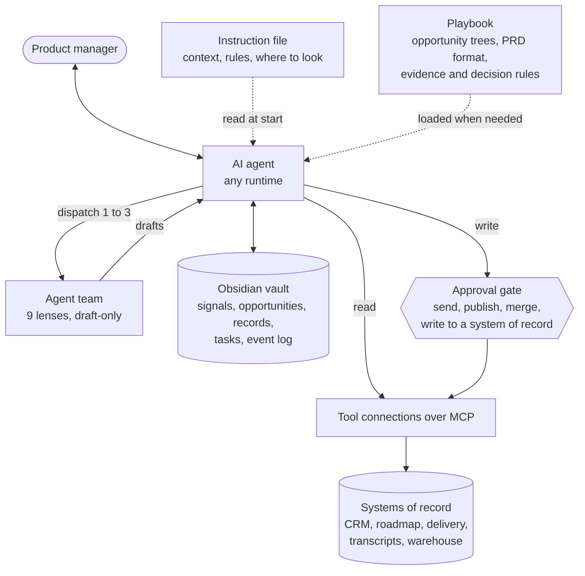

  <a href="../README.md">← Portfolio</a> ·
  <a href="docs/systems-of-record.md">Systems of record</a> ·
  <a href="docs/product-playbook.md">Playbook</a> ·
  <a href="docs/workflow.md">Workflow</a> ·
  <a href="docs/agent-team.md">Agent team</a> ·
  <a href="docs/knowledge-vault.md">Vault</a> ·
  <a href="docs/portability.md">Portability</a>

# ai-product-blueprint

| My role | Built from | Runs on | Status |
|---|---|---|---|
| Designed it and ran it | Nine months of daily use at a UK hospitality commerce company (luxury hotels and spas) | Any AI agent that reads an instruction file, loads skills and connects to tools over MCP | Design; the team and the checks run in my own vault today |

This is how I set up product work so that AI agents do the reading and drafting and a person makes the decisions. It covers four parts: the systems each fact lives in, the playbook that turns a customer signal into a spec, the team of agents that drafts the work, and an Obsidian vault (a folder of linked notes) that holds the decisions, the reasoning behind them and the tasks.

[pm-agent-os](../pm-agent-os/) tells the story of the system I built and ran. This piece is the reusable design that came out of it, written so another team could adopt it with whichever AI agent they use.

## The problem

A product team's facts are spread across many tools. Customers live in the CRM (the customer database), priorities in the roadmap tool, work in progress in the delivery tool, what customers said in call transcripts, and usage in the data warehouse. Agents that read across all of them save hours a week. They also create two new risks: an agent can copy a fact into a second place where it goes stale, and it can write into a system the company depends on without anyone checking.

A third risk is lock-in. The system I built ran first on OpenCode (an open-source AI coding assistant) and then on Claude Code (Anthropic's assistant). When I moved it, the parts that survived without rework were the ones held in plain files: the playbook, the note formats and the instruction file. The parts tied to one tool's conventions had to be rebuilt. So I wrote this design with every rule in plain files and every tool connection over an open standard.

## Five principles

1. **Each fact has one home.** The CRM owns customers, the roadmap tool owns priorities, the delivery tool owns work in progress. The vault owns what those tools lose: decisions, reasoning, lessons and the log of what happened.
2. **Agents draft, a person decides.** Anything that leaves the vault, such as a message, a roadmap change, a code merge or a write to a system of record, waits for a person to approve the exact content.
3. **Log facts before summarising them.** Reports are built from small facts recorded as work happens. An audit of my first weekly report found invented figures, because it summarised summaries.
4. **The method lives in files.** Playbook, note formats, routing rules and checks are markdown and plain properties. Agent features such as subagents and hooks are adapters that apply them.
5. **Important rules are checks.** A rule that matters runs as an automatic check that blocks the action. Where a tool has no hooks (scripts that run before or after the agent acts), the same check runs as a test or a scheduled script.

## How the parts fit

MCP (Model Context Protocol) is the open standard most AI agents use to connect to other software. Reads go straight through. Every write passes the approval gate first.

## The four parts

| Part | What it settles | Read |
|---|---|---|
| Systems of record | Which tool owns which fact, what agents may read and write, and where approval sits | [systems-of-record.md](docs/systems-of-record.md) |
| Product playbook | Opportunity trees at strategic and tactical level, the evidence needed at each node, who decides what, and the two-part PRD (product requirements document) | [product-playbook.md](docs/product-playbook.md) |
| Workflow and agent team | The four phases from capture to rollout, the daily rhythm, and nine draft-only lenses with one primary per task | [workflow.md](docs/workflow.md) · [agent-team.md](docs/agent-team.md) |
| Knowledge vault | Folder model, note types and their properties, decision records, task statuses, and views | [knowledge-vault.md](docs/knowledge-vault.md) |

[portability.md](docs/portability.md) maps each part to what an agent runtime must provide, with a fallback when it lacks a feature.

## A signal's path through the system

1. A customer says on a call that guests cannot add a spa treatment to a room they have already booked. A daily routine pulls the gap from the transcript and files it in the roadmap tool as a customer insight, with the quote and the customer's company attached.
2. The insight is linked to an opportunity that already holds similar evidence. The opportunity's demand rises a tier on the scale once three independent sources agree.
3. The opportunity sits under an objective, which sits under a company outcome. It must pass at least one of the company's value checks to stay on the tree.
4. A product manager promotes it to discovery. Agents draft the PRD in two parts: a one-page decision surface and an evidence layer. A format check blocks the write to the roadmap tool until the PRD meets the standard.
5. Three lenses (product, design, engineering) review the PRD in parallel. The people they stand in for make the call.
6. After launch, the impact report feeds new signals back into capture.

## Evidence

- Ran for nine months as my daily system, from a generic agent library to handover; the build history, figures and failures are in [pm-agent-os](../pm-agent-os/).
- Survived one change of agent runtime. The playbook and note formats moved across as they were; the coordinating agents and a custom shared-context convention had to be rebuilt.
- The agent team, the outbound style check and the task conventions run in my personal vault today, rebuilt from scratch with no employer material.

## In this folder

This folder documents the design. The original system and its code are private; everything here is a new write-up.

- [docs/systems-of-record.md](docs/systems-of-record.md): ownership of facts, read and write rules, connection choices.
- [docs/product-playbook.md](docs/product-playbook.md): opportunity trees, evidence scale, decision rights, PRD structure.
- [docs/workflow.md](docs/workflow.md): capture, discovery, delivery and rollout, with the gates and the daily rhythm.
- [docs/agent-team.md](docs/agent-team.md): the nine lenses, routing rules, the handoff lane and lesson memory.
- [docs/knowledge-vault.md](docs/knowledge-vault.md): the vault as knowledge base and task system.
- [docs/portability.md](docs/portability.md): what each part needs from an agent runtime.
