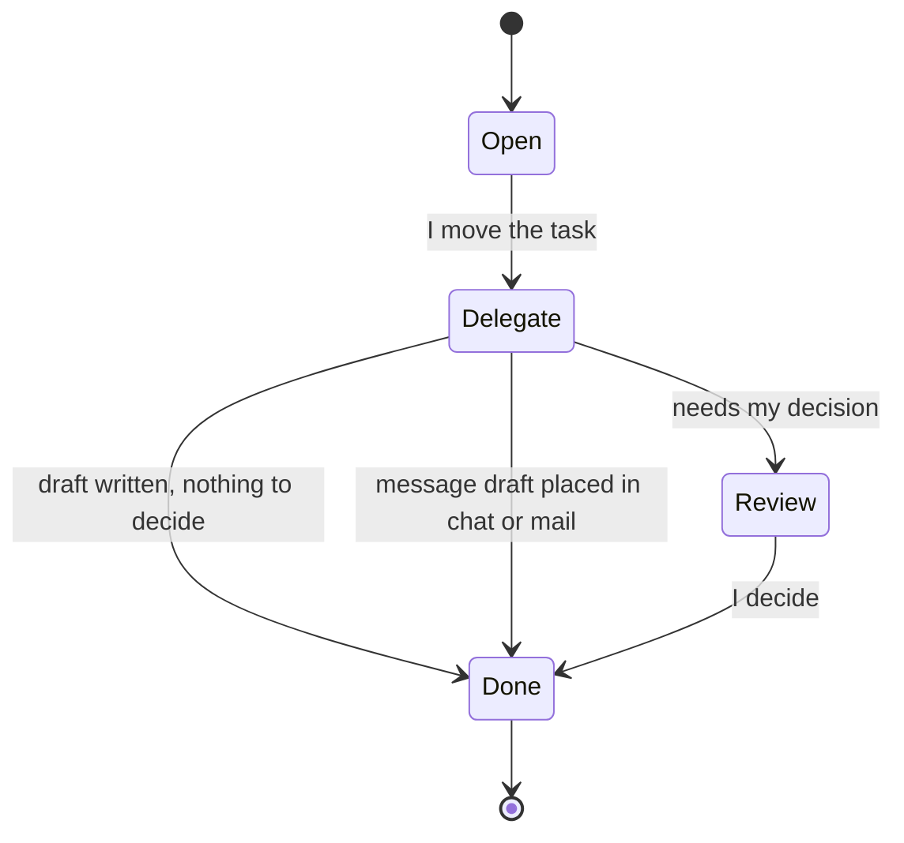

# Agent team

Nine lenses, each owning one kind of question. A lens drafts and returns text. The main session, where I talk to the agent, decides which lenses to use, briefs them and puts their answers together.

A subagent is a helper agent that runs one task in its own working memory and returns a result. Most agent runtimes have them; [portability.md](portability.md) covers runtimes without.

## The nine lenses

| Lens | The question it owns | Special role |
|---|---|---|
| Product | Is it valuable and viable? What problem, for whom, on what evidence? | Default primary; tiebreaker of record |
| Engineering | Is it feasible? What does the code or system actually do? | Settles technical claims against the code itself |
| Commercial | What does it do to customers, revenue, retention, deals and pricing? | |
| Operations | Who runs it day to day, on what rhythm, and what breaks at handover? | |
| Design | Is it usable, clear and credible to look at? | |
| Marketing | How is it positioned, against whom, at what price, through which channel? | |
| Legal | What contract, regulatory, privacy or confidentiality limits apply? | Stops anything that crosses a limit |
| Data | Can it be measured? Definitions, baselines, sources, sample size | |
| Finance | Do the unit economics and the money work? | Veto on unit economics |

Each lens exists in two forms. The **interactive form** is a skill (a written procedure the agent loads) that I talk to directly, for a longer conversation in one lens. The **delegate form** is a short subagent definition: the lens, its default ways of thinking and the shared context, with no routing of its own. Other workflows send work to delegates. Subagents cannot start other subagents, so routing always lives in the main session.

## Routing rules

1. **Do it inline when it is small.** If one lens is obvious and writing the brief would take longer than the answer, the main session answers in that lens. This is a valid outcome.
2. **Split the question.** Each sub-question goes to the lens that owns it.
3. **One to three lenses, one primary.** The primary writes the combined answer. Contributors supply their lens only.
4. **Choose the primary by what the output is.**

| Primary | When |
|---|---|
| Product | The answer weighs value across lenses: a bet, a priority, a strategy test |
| Engineering | Feasibility decides it: architecture, hosting, a change to code. Legal joins when a regulatory limit applies |
| Marketing | Competitive, pricing or positioning research, with finance contributing |
| Legal | Whether something may be done or published at all |
| Data | Whether a claim or metric holds |
| Finance | A model, budget or investment case |
| Design | A screen, page or document is the deliverable |
| Operations | A process, routine or handover is the deliverable |
| Commercial | A customer, deal or account-health question |

5. **Binding constraints first.** When engineering reality, a legal limit or a finance veto could end the idea, that lens runs first and the primary works within its answer.
6. **Decision reviews run blind.** To pressure-test a decision, the relevant lenses run in parallel without seeing each other. Product breaks ties. I can overrule the panel, and the record then says it was an override.

## Briefing a delegate

Every brief carries the task in full with links to the notes it needs, the sub-question this lens owns, who the primary is, what is already settled, the shape and length of answer expected, and the house rules: draft only, and every claim labelled as evidence (with its source), inference or assumption.

Delegates end with a list of questions. The main session collects them after all delegates return and asks me once. A delegate that stalls while exploring is sent again with a tighter brief naming the exact files.

## The handoff lane

Handing work to the team uses two extra task statuses on the existing task board. A runner wakes three times a weekday, takes up to three tasks from Delegate, routes each with the rules above and writes the primary's combined draft onto the task. Review holds only decisions I must make. When it also held finished work and messages to send, it filled faster than I cleared it.

## Learning from corrections

When I correct an agent, the session log turns the correction into a short lesson note: one rule, the trigger, the evidence. A script compiles active lessons into a digest with a size cap, and each brief includes the digest. A lesson that recurs is written into the skill or instruction file it belongs to and retired from the digest.

I first keyed lessons to lenses. Most corrections happened in ordinary sessions with no lens in use, so most lessons reached no lens. This design keys them to the workflow or skill in use when the correction happened, so each lesson loads where it was learned.

## Measuring trust

Each dispatch writes one line to a ledger: date, task, lenses, primary. When I use or discard the output I mark it kept, partly kept or not kept. A lens whose output is rarely kept gets rewritten or retired. The system I ran at work had no such record, so I could not say how often the team helped; this ledger now runs in my own vault.

## Before lenses: phase orchestrators

The first version had one coordinating agent per phase (capture, discovery, delivery, rollout), each calling specialists under it. It mirrored the operating model closely. It also meant a quick second opinion needed a whole phase run, so I added a consult mode, and then removed the coordinators when I moved runtime. Lenses map to the people a product manager actually asks, and the phases now live in the playbook and the task board. See [pm-agent-os decision 0003](../../pm-agent-os/docs/decisions/0003-persona-as-skill-plus-lean-delegate.md).
