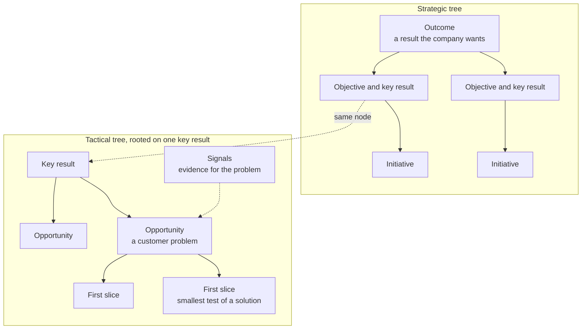

# Product playbook

The rules agents and people follow to get from a customer signal to a spec. Agents load the part they need for the task in hand. Every rule here is short enough to check, because an agent applies a check more reliably than a principle.

PRD means product requirements document: the spec a team builds from.

## Opportunity trees

An opportunity tree starts from the result you want and branches into the ways you might reach it. The same shape works at any level, and I use it at two.

- **Strategic.** Company outcomes branch into objectives and key results, and those into the initiatives that should move them. This tree shows leadership how each piece of work connects to an outcome.
- **Tactical.** One outcome or key result branches into the customer problems that stand in its way, and each problem into candidate solutions and the smallest tests of them. This tree gives a team clarity on how they will move the number they own.

The root of a tactical tree is a node of the strategic one, so the two connect without being kept as one diagram.

| Node | What it is | Key properties | Ready when |
|---|---|---|---|
| Outcome | A result the company wants, such as more spend per customer or less support effort | Owner, the metric | Set by leadership |
| Objective and key result | A bet towards an outcome with the number that shows it worked, ranked within its investment type | Investment type, demand tier, lagging metric, trigger | It names the product lever it moves, beyond restating the outcome |
| Initiative | A body of work committed against a key result | Owner, linked key result, status | It traces to one key result |
| Opportunity | A customer problem standing between the team and its key result | Linked signals, signal count, date of the latest signal, value checks passed, demand tier | The readiness test below passes |
| Signal | One piece of evidence: a quote, an observation, a ticket | Source channel, who is affected, problem area, evidence type (quote, observation or inference) | It describes what is broken without proposing a fix |
| First slice and PRD | The smallest thing that would show a solution is worth more work | See the PRD section | The format check passes |

Signals enter with no filter. One signal rarely justifies anything, so the product manager merges signals into opportunities and lets evidence build up before judging. Bugs and compliance work skip the tree and go straight to the delivery backlog.

An objective that only restates a company goal ("increase revenue") is transcription. It must name the product lever, such as the share of orders with more than one product. Agents flag transcribed objectives instead of ranking against them.

## Value checks

Each opportunity must pass at least one value check to stay on the tree. The checks come from the company's strategy, so each business writes its own and rewrites them when its direction changes. Keep them to two or three questions a product manager can answer in one sentence each.

For a hotel and spa commerce business, the three I used asked:

- Does it add something customers can buy, or make existing supply easier to reach?
- Does it raise what each customer spends?
- Does it lower the cost to deliver or support each sale?

A subscription business might ask about retention and expansion instead; a marketplace about liquidity on both sides.

An opportunity that fails every check is declined with a reason sent to the person who raised it. If they disagree, they can take the commercial case to the leadership forum that rules on deals.

## Demand scale

| Tier | Meaning | Evidence |
|---|---|---|
| 0 | Not demand-led: upkeep or a strategic bet | The case stands without customer demand |
| 1 | Anecdotal | One or two mentions from one source |
| 2 | Emerging | Three or more independent signals pointing the same way |
| 3 | Validated | Several channels, interviews and numbers |
| 4 | Strong | Validated, plus live commercial urgency with named accounts |
| 5 | Waiting on a trigger | Validated, but blocked by an outside event with a known date |

Agents set the tier from the linked signals and must cite them. The tier can only go up when a new independent source arrives.

Financial analysis gains weight as confidence grows. At capture it plays no part. In discovery it sets spending limits only. In delivery unit economics shape scope. After rollout, return on investment is the main measure. Applying a revenue model too early turns guesses into apparent facts.

## Who decides

The first question is whether the decision can be undone quickly and cheaply. Every decision record carries this as its door type: two-way if it can be undone, one-way if it cannot.

| Decision | Decider |
|---|---|
| Reversible, inside an approved objective | Product manager, telling the product trio (product manager, designer and tech lead) |
| What goes in the first release, architecture, anything irreversible inside an objective | The trio, all three agreeing |
| A new objective, more discovery time, a dependency on another team | Head of product |
| The split between investment types, a new market, a partner commitment | Leadership |

When in doubt, go one level up.

## Prioritising

Work is split into three investment types, set each quarter before objectives are written: **Transform** changes the business model, **Grow** makes existing products more valuable, **Run** keeps the platform reliable and compliant. Objectives are force-ranked within each type.

Inside an objective, candidates go on an impact and confidence grid. High impact with high confidence is done first. High impact with low confidence goes to discovery. Low impact with high confidence is parked with a review date. Low on both is declined. Confidence draws on the demand tier, whether we know how to build it, and how well we understand the user's problem.

## Discovery

Discovery gets a time budget of roughly a tenth to a seventh of the expected build time, capped for multi-quarter work, after which it escalates. An opportunity enters discovery only when the product manager can say yes to each of these:

- Several sources confirm the problem.
- It passes a value check, explained in one sentence.
- The problem can be described without a solution.
- It ties to an active or planned objective.
- The trio has placed it on the grid.
- A trio owns it, and delivery and marketing leads have had a short heads-up.

A PRD revised more than three times on scope or framing escalates, whatever the time budget says.

## The first slice

Before anyone writes a PRD: what is the smallest thing we could ship that would tell us whether to build more?

- It ships on its own and solves one problem end to end, even for a narrow group.
- It names what it leaves out.
- Its value fits in two sentences.
- It states the learning: "if this works, this metric moves by this much within this time".
- It fits in one or two sprints.

## PRD structure

A PRD has two parts with different readers.

**Decision surface.** One read for the person deciding. Exactly three sections:

1. **Summary.** The problem in one sentence naming who carries it, why now, and the shape of the fix kept deliberately thin.
2. **The numbers.** The driver it moves, the upside in a unit that fits the bet, the one decision metric, and the counter-metric that must not get worse with the threshold that stops the work.
3. **Blocking questions.** Named only; the detail sits in the evidence layer.

The decision surface carries no recommendation. The trio decides from it.

**Evidence layer.** Always present: scoreboard (each metric with current value, target, method and window), strategic fit against the value checks, counter-metrics, validation plan with exactly one decision metric, personas, risks, options with the case against the easy one, open questions with owner and recommended answer, and feasibility evidence written for the tech lead. Scope, architecture, non-functional requirements and go-to-market are added only once the work is planned, so a scope line written in discovery does not go stale.

Every claim in the evidence layer is labelled as evidence, inference or assumption. The decision surface states uncertainty in plain words.

## Checks agents run

| Check | When | Result |
|---|---|---|
| Format check | Before any PRD reaches the roadmap tool | Pass, or a list of failed rules with the fix for each |
| Problem check | After a PRD is drafted | Four questions: is the user problem evidenced, is today's workflow understood, are success measures defined by the user, is the cost of leaving it quantified. Any no sends it back to discovery |
| Trio review | Before build | Product, design and engineering lenses each return approve, conditional or reject with the gaps named. People make the final call |
| Compliance check | During trio review | Work that touches personal data, payments or regulated flows must show how the design complies from the start. Without that, the verdict is conditional |
