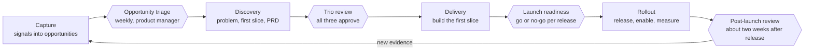
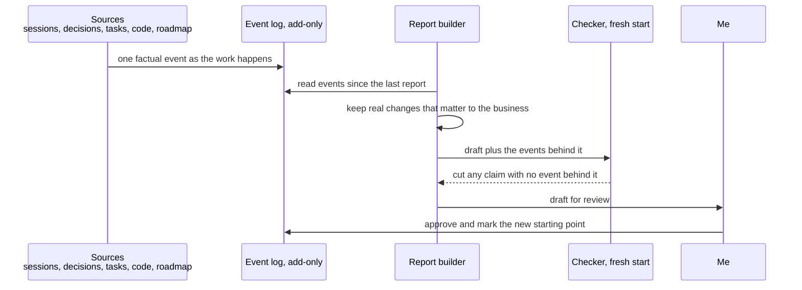

# Workflow

How work moves through four phases, where agents help, and where a person decides. The phases repeat: what rollout learns becomes new evidence for capture.

A lens is one of the nine draft-only agents described in [agent-team.md](agent-team.md). A gate is a point where people decide before work moves on.

## The four phases

| Phase | Goes in | What agents do | Comes out | Gate |
|---|---|---|---|---|
| Capture | Calls, tickets, sales notes, research, market news | Pull gaps from call transcripts, file evidence against the customer's company, propose which opportunity it belongs to, set the demand tier with citations, run the value checks | Opportunities with linked evidence, ranked within each objective | Opportunity triage: the product manager promotes the top few to discovery |
| Discovery | A promoted opportunity | Draft interview guides and synthesise interviews, draft the first slice and the PRD, run the format and problem checks, give product, design and engineering views in parallel | A PRD that passes its checks, user stories, and a handoff pack for delivery | Trio review: product manager, designer and tech lead each approve, approve with conditions, or reject |
| Delivery | The approved first slice | Trace the change through the code, draft tickets, make small low-risk fixes in an isolated copy of the code and open a draft pull request (a proposed change an engineer reviews) | Working software, technical notes, compliance evidence, a rollback plan | Launch readiness: a go or no-go with the people who carry the release |
| Rollout | The release | Draft the rollout plan, enablement notes for sales and support, release notes, and the impact report from the warehouse | A measured result against the decision metric | Post-launch review: did the metric move, and what next |

Each handoff passes a pack of named documents, so the next phase starts from the evidence and does not repeat it. Agents never pass a gate on their own. They prepare the material for it and record the decision afterwards.

## The daily rhythm

| When | What runs | Output |
|---|---|---|
| Start of day | A routine reads the calendar, due tasks and overnight results | A plan for the day in the daily note, with the meetings that need preparation |
| After each meeting | A routine processes the transcript | Meeting note with decisions, risks and open questions split into their own records |
| Through the day | I work with the agent; it routes questions to the lenses | Drafts, records, tasks |
| Three times a weekday | The handoff runner picks up tasks I moved to the Delegate column | A draft on each task, or a message draft in the chat or mail tool |
| End of a session | A session log | A session note, new decision and risk records, and any lesson from my corrections |
| As work happens | Small scripts log one factual event each | An add-only event log |
| Weekly | The report routine | A draft weekly report built from the event log, for me to edit and send |

## The weekly report

My first weekly report summarised daily notes and then summarised the summaries. An audit found invented figures and inflated verbs. The event log fixed it. Each event's verb caps how strongly the report may describe it, so "started" cannot become "delivered". The checker starts with no access to the drafting conversation and keeps only what an event supports. Only updates I wrote myself may lead the report, because routine events otherwise filled most of it.

## Rules that hold in every phase

- Agents draft; people decide at every gate and approve every write outside the vault.
- Each decision becomes its own record with a decider, a date and a door type (two-way if easy to undo, one-way if not).
- Every claim is labelled as evidence, inference or assumption.
- Customers' personal data and verbatim source text stay out of automated outputs.
- An unattended routine runs the same commands and checks as an attended session.
