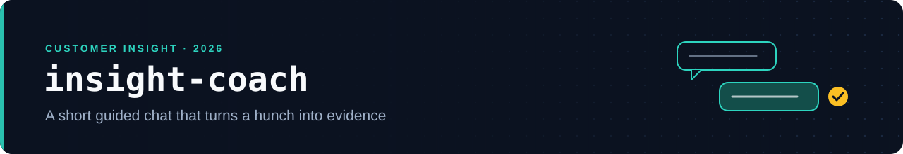
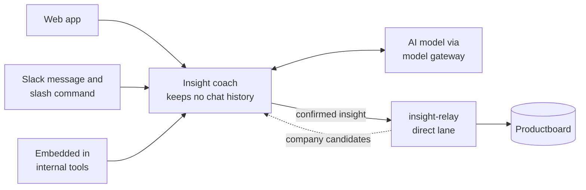

  

  <a href="../README.md">← Portfolio</a> ·
  <a href="docs/architecture.md">Architecture</a> ·
  <a href="docs/decisions/">Decisions</a> ·
  <a href="BUILD-LOG.md">Build log</a>

| My role | When | Built with | Status |
|---|---|---|---|
| Designed and built it | Jun to Nov 2026 | Web app on Vercel, Slack, model gateway, Productboard | Live on web and Slack; handed over Nov 2026 |

A short coached chat that helps colleagues turn "something I noticed about a customer" into a clear product insight. Each insight starts with the customer's problem, records how strong the evidence is, and lands in Productboard (the tool the product team uses to collect and prioritise feedback), credited to the customer and to the colleague who raised it. I designed and built the original in 2026 at a UK hospitality commerce company serving luxury hotels and spas.

This repository documents the design: architecture, decisions, build history and lessons. The original system and its code are private.

## The problem

Colleagues who talk to customers every day noticed things the product team needed to hear. What reached the roadmap was thin and usually arrived as a ready-made solution. In a sample of a few hundred change requests raised through the old intake board, about 9% opened with the problem. Most named a feature to build, and the rest were too short to classify. People were busy, and nobody had shown them how to frame a request. Some already ran requests through a general AI assistant, which made them read better and hid that they started from a solution.

Trust was the second problem. Colleagues sent feedback to product and heard nothing about what happened to it.

## Who it was for

- Colleagues in customer-facing roles, working without a Productboard licence or training.
- The customer success team, who moved their change-request intake onto a dedicated mode of the coach.
- Product managers triaging the insights board, who received the output.

## What it does

The person raising the insight (the raiser) types what they noticed, in any shape. The coach asks up to three questions: the problem behind the request, the evidence, and how often it happens or what it costs, if that is missing. The raiser can file as-is at any point. The coach then shows a card with every field it will file, and the raiser confirms before anything reaches Productboard.

A sample conversation, with invented content:

> **Raiser:** Can we add a bulk export to the bookings report? Example Hotel Group keeps asking.
>
> **Coach:** What are they trying to get done when they ask for the export?
>
> **Raiser:** Their revenue manager pulls each hotel's spa bookings one by one every Monday and stitches them into a group report. Five hotels.
>
> **Coach:** Did she tell you that, did you see it happen, or is it your read of the situation?
>
> **Raiser:** She told me on a call. "I lose Monday mornings to this."
>
> **Coach:** Here's what I'll file. Change anything that's wrong, then confirm.
>
> | Field | Value |
> |---|---|
> | Title | Group revenue manager rebuilds a cross-hotel bookings report by hand each week |
> | Problem | Example Hotel Group has no group-level view of spa bookings, so their revenue manager exports each hotel separately and combines the reports every Monday. |
> | Evidence | Quote: "I lose Monday mornings to this." |
> | Arrived as | Solution |
> | Customer | Example Hotel Group |
> | Raised by | You |

The coach kept "Monday mornings" exactly as the raiser said it. The export the raiser asked for travels with the note in their own words, and the problem statement describes the need behind it.

The rules behind each field are in [docs/coaching-design.md](docs/coaching-design.md).

## How it evolved

It started as a web app on Vercel (a hosting service), behind company sign-in. A Slack front-end followed, with the same confirm card. Later, two internal tools embedded it in a pop-up window and signed users in with a short-lived token: a signed pass the host tool issues for a few minutes. The server keeps nothing between conversations. The browser holds the chat, and Productboard is the only system of record. Calls to the AI model moved behind a model gateway, one service that every model call passes through. Confirmed insights file through the direct lane of the sibling [insight-relay](../insight-relay): a web address other tools send a single note to, which files it at once and sends back a link.

Full diagrams are in [docs/architecture.md](docs/architecture.md).

## Key decisions

- [0001](docs/decisions/0001-coach-dont-polish.md) A coached chat of up to three questions, with filing open at every turn.
- [0002](docs/decisions/0002-evidence-tiers-only-round-down.md) Evidence is tiered as quote, observation or inference, and any doubt rounds it down.
- [0003](docs/decisions/0003-origin-flag-from-first-message.md) How an insight arrived is judged from the first message only.
- [0004](docs/decisions/0004-confirm-before-file-verbatim-text.md) The raiser confirms every insight before it files, and their own words travel unchanged.
- [0005](docs/decisions/0005-stateless-server.md) The conversation lives in the browser, and the server keeps no database.
- [0006](docs/decisions/0006-embed-with-signed-token.md) Other tools embed the coach through a signed, short-lived token.
- [0007](docs/decisions/0007-fixed-problem-themes.md) Problem themes come from a fixed list.

## Outcomes

- The number of people filing insights rose almost tenfold in the two weeks after launch. Setting my own notes aside, daily insights roughly quadrupled.
- In the first six weeks, 88% of the people who started a chat filed an insight, and almost everyone who reached the draft card (99%) filed.
- The customer success team moved its change-request intake off its old board and onto the coach.
- When two internal tools needed a feedback route, their teams embedded the coach. One went live. The second, which opened the coach to that tool's customer users, was built and awaiting review when I handed over.
- By volume the coach was a minor channel. Most insights logged in that period came through the relay's automated lanes.

Measured: adoption and completion, above. Not yet measured: whether insights became more problem-first. The pilot named two success measures, the problem-first rate against the 9% baseline and an actionability rating from product managers. What would settle it: scoring a sample of filed insights against the old baseline.

## What I'd do differently

- **Keep every insight the model drafts.** I read the model's free-form JSON (structured text the model returns) and discarded anything that failed to parse or validate. Good insights disappeared with no error the raiser could see, once because the output came wrapped in formatting and once because a field value fell outside the agreed fields. I'd constrain the model's output to the agreed fields, map uncertain values to the weakest option, and show the raiser a retry.
- **Hold my own quality gate.** I made a passing evaluation run (automated tests of the coach's answers) mandatory before any prompt change, then waived it more than once under delivery pressure. The CI job (the automated checks that run on every change) had no API key, so the evaluations skipped and the build still showed green. [docs/evaluation.md](docs/evaluation.md) covers the design I'd use, where a skipped check fails the build.
- **Finish the external launch or scope it out.** I built the embed for a second tool's customer users and handed over with it awaiting review. I had merged nearly everything else myself, with no required reviewer, so review arrived late and blocked it. I'd require a second reviewer from the first commit and scope launches to land before a handover.
- **Measure the claim the pilot was for.** I tracked the funnel from chat to filing. I'd score a sample of filed insights against the old baseline from the first month.

## Repo contents

- [docs/coaching-design.md](docs/coaching-design.md): the structure of a coached insight and the rules behind it.
- [docs/architecture.md](docs/architecture.md): context, session sequence, conversation states, embed flow.
- [docs/evaluation.md](docs/evaluation.md): how coaching quality was gated and how the gate eroded.
- [docs/decisions/](docs/decisions/): decision records, one short note per design choice and its reasons.
- [BUILD-LOG.md](BUILD-LOG.md): build history by month.
