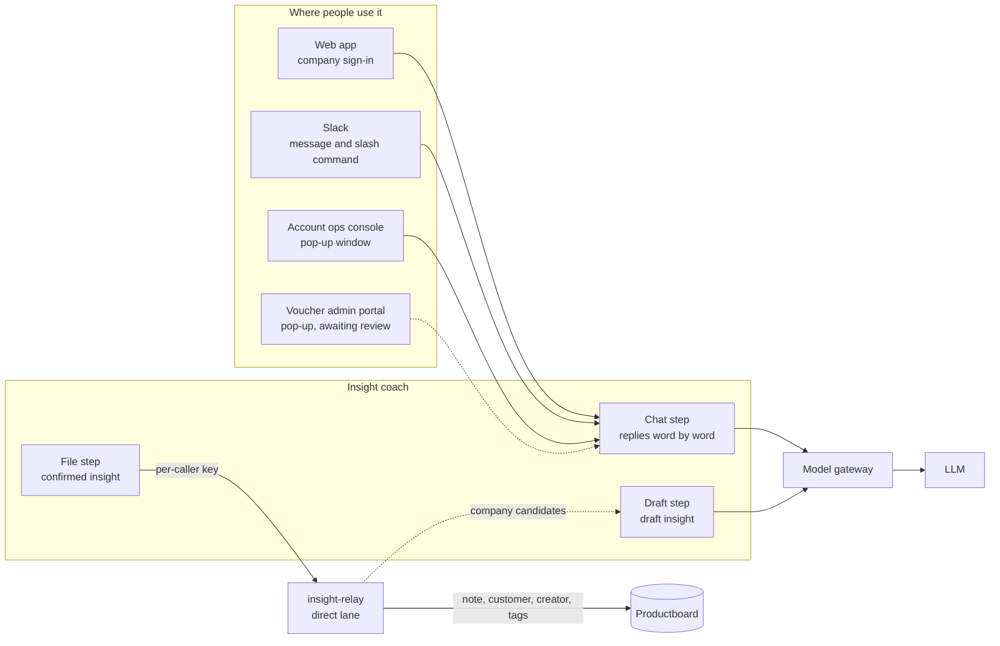
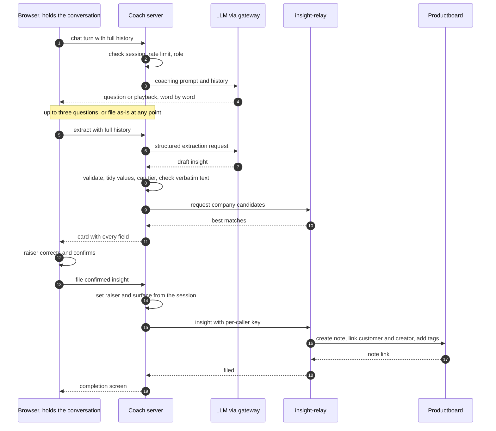
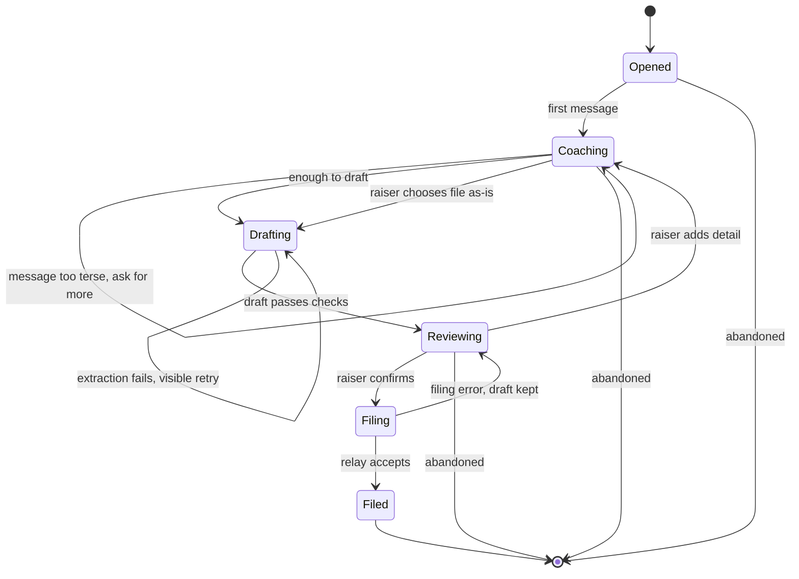
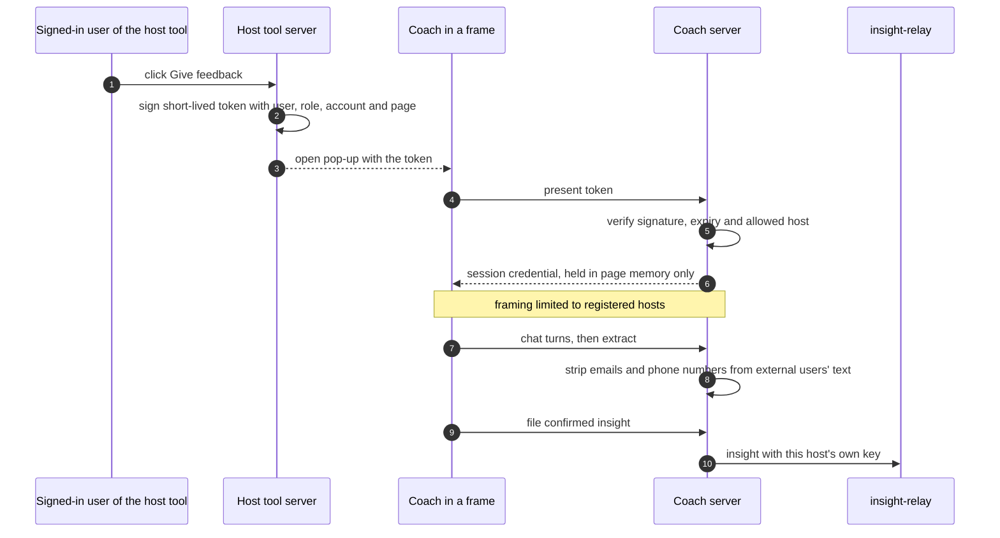

# Architecture

The coach was one web application with three entry points, and conversations lived in the browser. It ran the conversation with the AI model and the confirm step. Filing belonged to the sibling [insight-relay](../../insight-relay) through its direct lane (a web address other tools send a single note to, which files it at once and sends back a link). The relay held the only Productboard credential (Productboard is the tool where the product team collects and prioritises feedback). The diagrams below describe the design at the level it can be shared, with generic names, hosts and identifiers.

Terms used below: an LLM (large language model) is the AI model that writes the coach's replies; the model gateway is one service that every model call passes through.

## 1. Context

Each surface runs the same coach and the same confirm card. The web app signed colleagues in through company single sign-on (one company login for every internal tool). Slack used a direct message and a slash command (a typed `/` shortcut). The two embedded surfaces signed users in with a token signed by the host tool (diagram 4). Three routes, or server addresses, did the work: a chat route that sent each coaching turn back word by word as it was written, an extract route that turned the conversation into a draft insight for the card, and a file route that sent the confirmed insight to the relay. The model sat behind the gateway, so every caller and the evaluation suite shared one key and one usage view. The relay created the Productboard note and its links, and served the list of candidate companies the card offered. The voucher admin portal's integration was built and awaiting review at handover, shown dashed.

## 2. A coaching session, through confirm and file

The browser sends the whole conversation with every request, so any server instance can answer, and a page refresh loses an unsent draft by design. Chat and extraction are separate calls. Chat runs at a higher temperature (the setting that gives the model more variety) and replies word by word; extraction runs at a lower temperature and returns structured fields. The server checks every draft before it reaches the card. It validates the shape, maps loose values to the nearest allowed one, caps the evidence tier and keeps the raiser's text verbatim. At filing time the server writes identity and surface itself, overwriting anything the browser sent.

## 3. Conversation states

The one way into Filed runs through Reviewing and an explicit confirm. File as-is skips the remaining questions and always shows the card. A draft that fails checks returns to Drafting with a retry the raiser can see, and a filing error returns to Reviewing with the draft intact. The visible retry is the corrected design; the README's lessons section covers the first version. An abandoned chat leaves nothing behind, because the server stores nothing.

## 4. Embedding in another tool

The host tool shows the coach in a frame, a page embedded inside its own. Company sign-in pages refuse to load inside a frame, and the host and coach sat on different sites, so they could share no browser cookies. The host tool's server therefore signs a token lasting a few minutes, bound to the user and the page they were on. The coach checks it and swaps it for a session credential lasting a couple of hours, kept only in page memory. A registry of hosts sets which sites may frame the coach and which relay key each one files with, so one host can be revoked and the others keep working. For users outside the company, the coach removed email addresses and phone numbers by pattern before the text reached the model or Productboard, kept their name and email out of every prompt, and turned attachments off where host screens could show guest data. [Decision 0006](decisions/0006-embed-with-signed-token.md) records the limits of pattern stripping.
