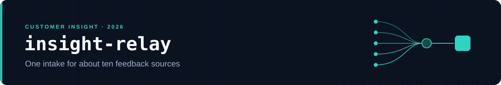
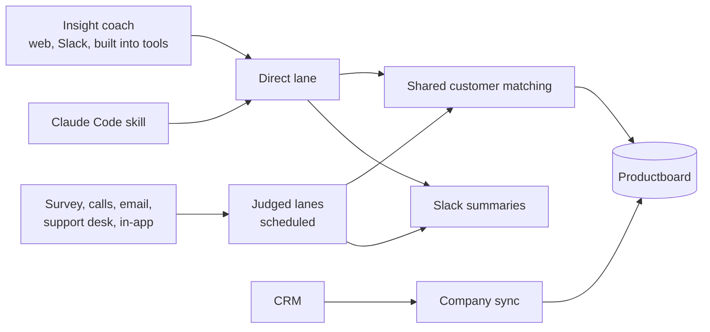

  

  <a href="../README.md">← Portfolio</a> ·
  <a href="docs/architecture.md">Architecture</a> ·
  <a href="docs/decisions/">Decisions</a> ·
  <a href="BUILD-LOG.md">Build log</a>

| My role | When | Built with | Status |
|---|---|---|---|
| Designed and built it | Jun to Nov 2026 | Vercel, GitHub Actions, Claude API as judge, Productboard | All lanes handed over, Nov 2026 |

One intake engine that took customer feedback from about ten channels and filed it in Productboard, the company's roadmap tool, with each note linked to its customer and tagged with where it came from. I designed and built the original in 2026 as Head of Product at a UK hospitality commerce company serving luxury hotels and spas. This repo is my own write-up of it, rewritten from scratch.

## The problem

Feedback reached the roadmap from surveys, customer calls, support tickets, email and colleagues, each by its own route. Every route had its own idea of what was worth filing. Few notes were linked to the customer who raised them, so a product manager could not see demand per hotel and an account manager could not see what their hotel had asked for. Every new route also meant handing out logins to the roadmap tool.

The first survey integration showed the cost of doing nothing clever: it filed every response, and the handful that described a real problem sank under the rest.

## Who it was for

- Product managers sorting through the feedback board in Productboard.
- Account managers who needed to see what a given customer had raised.
- Leadership reading the board for patterns across customers.

## What it does

Feedback comes in through two lanes. Both share one set of rules for linking a note to its customer, tagging it and handling failures.

The **direct lane** is a webhook: a web address other tools send a single note to, which files it at once and sends back a link. It serves tools where a person has already confirmed the note. The **judged lanes** run on a timer, collect feedback in bulk, and use an AI model (a large language model, or LLM) as a judge to decide what is worth filing.

| Lane | Channels | Who approves a note | Runs on |
|---|---|---|---|
| Direct lane | The insight coach (a chat assistant that helps staff write up feedback) on web and Slack, the coach built into two internal tools, and a Claude Code skill (a packaged command for Anthropic's coding assistant) | The person filing, on a confirm card | Vercel, a hosting service |
| Judged lanes | Survey tool, call transcripts, email, support desk, in-app feedback | Nobody per note. The AI judge applies a written charter, the rules for what counts. A person grades sample summaries before a lane goes live | Scheduled jobs on GitHub Actions, GitHub's automation service |
| Company sync | CRM (the customer relationship system) | n/a | A daily scheduled job on Vercel that keeps every customer company current in Productboard |

Each judged lane fetches new items, skips anything already filed, asks the judge whether each item describes a specific product problem, removes personal details, and files the ones that pass with a tag naming their source. A new lane starts in dry-run, a test mode: it posts what it would have filed to Slack and files nothing until someone switches it live.

Full diagrams, including step-by-step runs of both lanes and how a note is matched to its customer, are in [docs/architecture.md](docs/architecture.md).

## Key decisions

- [0001](docs/decisions/0001-two-lanes.md) Two lanes: a direct lane for tools where a person has already confirmed the note, a scheduled pipeline for channels the AI judges.
- [0002](docs/decisions/0002-one-engine-many-channels.md) One engine for every channel, so a change to the quality bar or customer matching applies everywhere at once.
- [0003](docs/decisions/0003-judged-lanes-need-no-approval.md) Judged lanes file without approving each note; the coach keeps its confirm step.
- [0004](docs/decisions/0004-dry-run-and-graded-digest-before-live.md) Every new lane runs in test mode, with a graded summary, before it files anything.
- [0005](docs/decisions/0005-attribute-to-customer-and-raiser.md) A note belongs to the customer it came from, is created by the person who raised it, and is owned by the product manager for that area.
- [0006](docs/decisions/0006-never-lose-a-note.md) When the roadmap tool refuses part of a note, the relay drops that part and keeps the note.
- [0007](docs/decisions/0007-provenance-tag-from-a-registry.md) Every note carries a source tag drawn from a fixed list, keyed by IDs that never change.

## Outcomes

- Within six weeks the relay carried feedback from every channel, most of it through the automated lanes.
- By the end of the second month the automated lanes filed five to ten times as many insights a day as the coach.
- Customer linking: I changed staff-filed notes to attach to the customer, where before they attached to the colleague who filed them, then updated every existing note with a clear customer, with no failures. A shared company cache cut the company lookup from about 12 seconds on a cold start to 0.5 seconds.
- The call-transcript lane went live with 96% accuracy on the notes I checked by hand.
- When two new internal tools needed a feedback route, their teams chose this pipeline.

Not measured: the split of insights by channel, and whether the relay changed what got prioritised. Raw note counts are a poor proxy for demand, because one noisy survey channel can dominate the board.

## What I'd do differently

- **Make "never lose a note" a rule from day one.** I first treated a tag the roadmap tool refused as a hard failure, and the relay lost notes because of it, by more than one route. Each time the note vanished without an error anyone saw. I now make every tag removable and send an alert when one is removed, and I'd write that rule before the first lane, as [0006](docs/decisions/0006-never-lose-a-note.md) records.
- **Hold my own quality gate.** The coach had a rule that its evaluation suite, a set of automated quality tests, must pass before any change to its prompt, the instructions the AI follows. I let that slip more than once under delivery pressure. The automatic check before merging (CI, continuous integration) ran without an API key, so it skipped quietly and still showed a pass. Next time the gate blocks the merge whenever it cannot run.
- **Build on shared accounts from the start.** I prototyped the first scheduled lanes on my personal Claude account with my own logins to the source tools, and alerts went to my direct messages. That was quick to start and slow to unwind: it put a single person in the failure path. I moved the lanes onto scheduled GitHub Actions jobs, and I'd start there.
- **Track every credential's owner.** When I audited the relay before handing it over, some credentials had no clear owner. I'd keep a credential register next to the code from the first deploy.

## About this repository

This repository documents the design: architecture, decisions, build history and lessons. The original system and its code are private.

## Repo contents

- [BUILD-LOG.md](BUILD-LOG.md): build history by month.
- [docs/architecture.md](docs/architecture.md): system diagram, step-by-step lane runs, customer matching.
- [docs/decisions/](docs/decisions/): decision records, one short note per design choice.

Sibling repo: [insight-coach](../insight-coach), the coached chat that feeds the direct lane.
