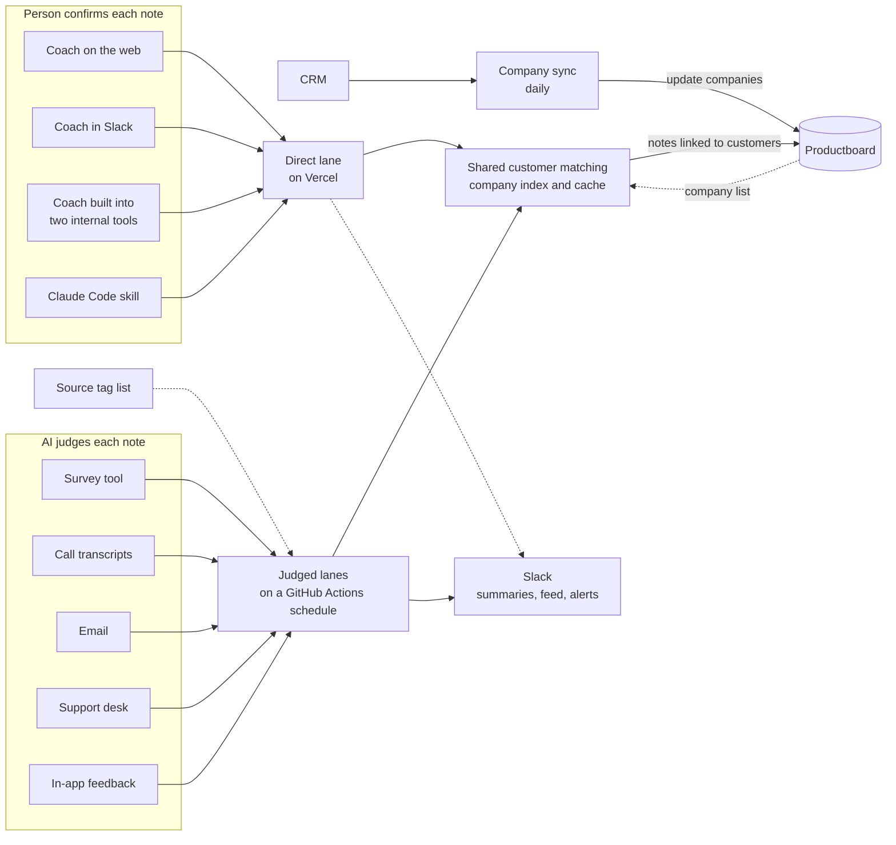
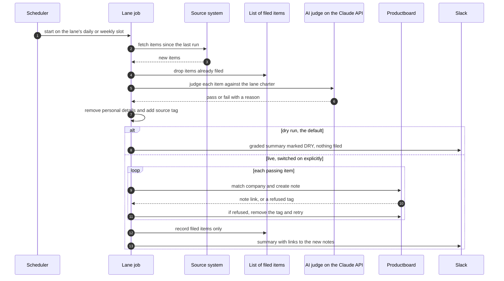
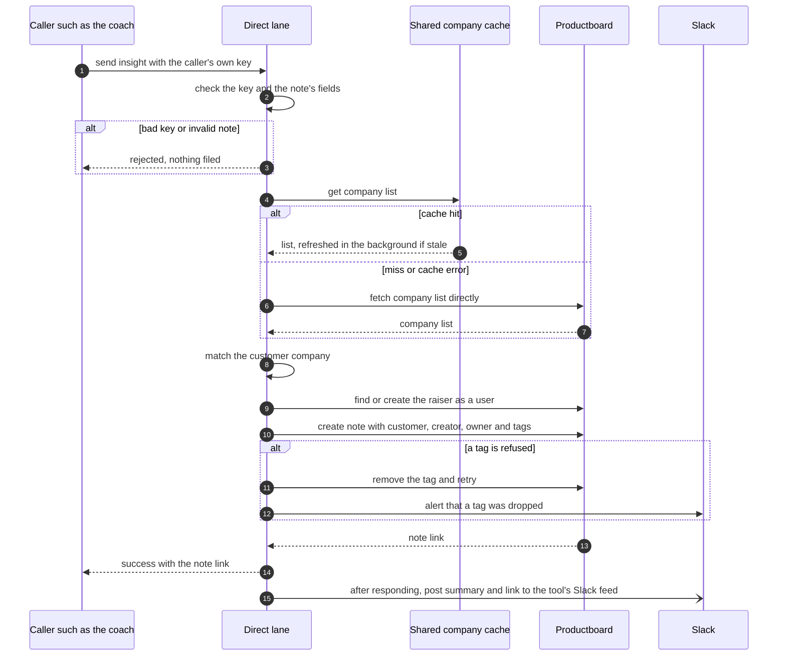
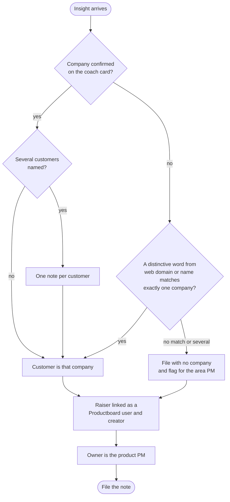

# Architecture

The original relay was two systems that shared rules and a destination. A service on Vercel, a hosting platform, ran the direct lane and the daily company sync from the CRM (the customer relationship system). A GitHub repository with scheduled jobs on GitHub Actions, GitHub's automation service, ran the AI-judged lanes. Both wrote to Productboard, the roadmap tool. I describe them here as one relay because they were designed, run and handed over as one.

Two terms recur. The **direct lane** is a webhook: a web address other tools send a single note to, which files it at once and returns a link. The **judged lanes** run on a schedule, fetch feedback in bulk, and ask an AI model (a large language model, or LLM) to judge each item against a written charter, the lane's rules for what counts.

## 1. Whole system

About ten channels feed the relay. On the left, a person has already confirmed each note before it arrives: the insight coach (a chat assistant that helps staff write up feedback) on its web app, in Slack and built into two internal tools, plus a Claude Code skill (a packaged command for Anthropic's coding assistant) that product staff used to file notes without a roadmap-tool login. In the middle, nobody confirms individual notes; each scheduled lane fetches from its source and the AI judge decides what to file. Both lanes match the customer company through the same code, which reads the company list the CRM sync keeps current. Slack receives summaries from the judged lanes, an optional feed of confirmed notes for each tool, and failure alerts. The in-app feedback lane was built and running in dry-run, a test mode that files nothing, when I handed the relay over.

## 2. A judged lane run

Each lane runs on its own schedule: the busier sources daily, the support desk and in-app feedback weekly. The list of filed items records an item only after it has been filed, so a failed item is retried on the next run. Each lane has its own written charter. The call lane, for example, files product gaps only, ignores pricing and competitor talk, caps itself at a few insights per call, and keeps a short quote as evidence with names replaced. The survey lane holds an answer that proposes a fix until a second customer raises the same topic. Every lane starts in dry-run and files only after an explicit switch, so a misconfigured lane posts a summary and changes nothing.

## 3. The direct lane

Each caller holds its own key, so one caller can be revoked without touching the others. The relay compares keys in constant time, a check that reveals nothing through how long it takes. It also checks that each note has the agreed fields, and rejects a bad key or a malformed note before filing anything. The company list sits in a shared cache on Vercel with a short freshness window. When the cached copy is out of date, the relay serves it and refreshes it in the background (a pattern called stale-while-revalidate). If the cache fails, the relay fetches the list directly and carries on. The raiser is created as a Productboard user the first time they appear, with a retry because a newly created user is not always visible straight away. The Slack feed posts a summary and a link, never the raw conversation, so personal details typed into the coach stay out of Slack. The feed is off for a tool until its channel is set up.

## 4. Matching a note to its customer

Matching answers two questions: which customer does this belong to, and who raised it. When a colleague files through the coach, the coach shows its best company matches on the confirm card and the colleague picks; they know the answer at filing time, so I asked them. Otherwise the relay builds an index of words that appear in exactly one company's name or web domain, and accepts only a single clear match. I ruled out loose name matching because it attached feedback to the wrong customer, which is worse than no attachment. A note with no match is filed without a company and flagged for the product manager (PM) for that area. It is never filed under the company's own name and never guessed to be a prospect. Filing never waits on matching.
