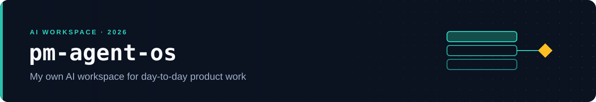

  

  <a href="../README.md">← Portfolio</a> ·
  <a href="docs/architecture.md">Architecture</a> ·
  <a href="docs/decisions/">Decisions</a> ·
  <a href="BUILD-LOG.md">Build log</a>

| My role | When | Built with | Status |
|---|---|---|---|
| Designed, built and ran it | Feb to Nov 2026 | Claude Code, Obsidian, MCP, hooks | Handed over, Nov 2026 |

From February to November 2026 I ran my job as Head of Product at a UK hospitality commerce company (luxury hotels and spas) with a set of AI agents I built. They planned my day each morning, processed my meetings, pulled product gaps out of customer calls, kept a record of every decision, drafted the weekly report to the leadership team, gave specialist views on request, and took tasks I handed over and returned drafts. Every message, publish or code merge waited for my approval.

The system ran on Claude Code (Anthropic's AI assistant, which works with files and runs tools) over an Obsidian vault (a folder of linked notes).

This repository documents the design: architecture, decisions, build history and lessons. The original system and its code are private; it lived inside the employer's vault and is their IP.

## The problem

A Head of Product's week is mostly reading, drafting and deciding, spread across a CRM (the customer database), a roadmap tool, call transcripts, Slack, email and code. I wanted agents to do the reading and drafting. I could trust that only if a person stayed on every decision with an effect outside the vault, and if the models writing about the work could not inflate the record of it.

## Design principle: agents draft, a human decides

Anything that leaves the vault waits for my explicit approval. Hooks (scripts that run automatically before or after the assistant acts) enforce this in code: one stops every outbound message until I confirm the exact text, and another checks its style first. Automated code work stops at a pull request (a proposed change that an engineer reviews before it goes live). Each decision is its own note with a named decider, a date and a door type: one-way if it is hard to undo, two-way if it is easy.

## Layers

| Layer | What it does |
|---|---|
| Personas | Nine role lenses (product, engineering, commercial, operations, design, marketing, legal, data, finance). Each works two ways: as a skill I talk to directly, and as a lean helper agent that other workflows can send work to. |
| Skills | Written procedures the assistant loads when it needs them: domain knowledge (payments, Stripe Connect for marketplace payouts, regulation), daily rituals (start and end of day, the weekly report) and connections to other tools. |
| Agents | Narrow helper agents (subagents), each working in its own context and returning a short structured result, so each step of a pipeline can be tested and replaced. |
| Commands | Slash commands I type, such as `/team`, for recurring rituals: logging a session, running handoffs, promoting lessons. |
| Hooks | Automatic checks at set points: the properties at the top of each note, outbound style, the send gate, a check that specs meet the house PRD (product requirements document) standard before they are written to Productboard (the product roadmap tool), and an event logged whenever a decision is saved. |
| Tool connections (MCP) | MCP is the standard way Claude Code connects to other software. Connected: Slack, email, calendar, documents, Productboard, call transcripts, the CRM, error monitoring, feature flags, Stripe, web analytics and the data warehouse. |
| Scheduled routines | Jobs that run on a timer: cloud routines for overnight and daily work, plus three jobs on my laptop (transcript sync and the handoff runner among them). |

Diagrams are in [docs/architecture.md](docs/architecture.md).

## Seven capabilities

1. **Weekly report built from logged facts.** An audit of the AI-drafted weekly report found invented figures, merged topics and inflated verbs, because it summarised summaries. I replaced it with an event log. Small scripts (emitters) add one short factual event to the log as work happens, and logged events are never edited. A filter keeps only events that matter to the business, each event's verb caps how strongly the report may describe it, and a separate checker that starts fresh cuts any claim with no event behind it. Built in under a week, with 32 tests on capture and 16 on the report side; live from 24 July 2026. Later reports show the checker cutting figures nobody had logged. See [decision record 0001](docs/decisions/0001-event-log-over-summarise-twice.md).
2. **Customer-call insight pipeline.** A daily routine pulls up to three product gaps from each customer call and files them in Productboard against the customer's company. Idea to production in two days. Of 27 gaps I checked by hand, 96% were correct, and every quote matched the call.
3. **CRM to Productboard sync.** A daily sync hosted on Vercel (a web hosting service). It keeps nothing between runs and only updates existing records. The first run updated every company record with no failures; 84 tests.
4. **AI-assisted code changes.** A risk classifier lets through only small changes that are easy to undo. Agents make the change in a sandbox (an isolated copy of the code) and open a draft pull request; an overnight runner picks up issues a person has labelled as ready. Three scoped fixes reached production in July 2026, each reviewed by an engineer. At launch the rule was that agents never merge their own changes. By handover, some repositories merged automatically once the automatic tests (CI) passed, so the rule held only in part. I flagged this in the handover notes.
5. **Agent handoff lane.** Dragging a task to the Delegate column hands it to a runner, which sends it to one to three persona agents and writes their draft onto the task. In October 57 tasks of three different kinds sat in the Review column, so I narrowed Review to my decisions only and moved message drafts into Slack or email.
6. **Request-to-code feedback routine** for an internal payments operations portal: it turns a user request into a proposed code change. Built in October 2026.
7. **Lesson memory.** When I correct an agent, the correction becomes a short lesson note. A script compiles each persona's lessons into a digest with a size cap, and lessons that recur get written into skills. 114 captured, 45 promoted, 4 retired. Tying lessons to personas barely worked: 102 of the 114 had no persona, because most corrections happened when no persona was in use.

## Safeguards

- Agents only draft outbound messages. Drafts of email, Slack and external posts land in Slack or email for me to send.
- A person approves every step with an irreversible effect: sends, code merges, Productboard publishes, and writes to systems of record (the systems the company treats as the source of truth).
- Every claim is classed as decided, proposed, opinion or unknown, and evidence as evidence, inference or assumption.
- Guest data and verbatim source text are barred from automated outputs. Third-party skills that could set up services or issue access keys were switched off.
- Delegates return text and take no action in other tools. See [docs/team-routing.md](docs/team-routing.md).

## Scale

OpenCode is an open-source AI coding assistant; the system ran on it before I moved it to Claude Code.

| Measure | March 2026 (OpenCode) | 6 November 2026 (Claude Code) |
|---|---|---|
| Commands | 19 | 36 |
| Agents | 21 (4 orchestrators, 14 specialists, 3 start-of-day) | 43 |
| Skills I wrote | 32 | 102 (146 installed) |
| Hook registrations | none | 15, from 13 scripts across 4 trigger points |
| Persona lenses | n/a | 9 |
| Decision records | n/a | 1,177 |
| Session notes (from 29 July) | n/a | 460 |
| Work events logged (from 17 July) | n/a | 4,470 |
| Lesson notes (from 5 October) | n/a | 114 |

## What I'd do differently

1. **Capture facts before building any summariser.** The weekly report failed because AI summarised AI summaries. Every later pipeline started from a log or a ledger; the first one should have.
2. **Start in company-owned accounts.** I started some services on personal accounts and moved them later, and replaced an access key that had been committed to the code history. Building for handover from the start would have cost less.
3. **Measure trust from the first run.** Not yet measured: how many handoff drafts I accepted. The lane kept no record, so the only throughput signal is a backlog of 57 tasks. Likewise the payments portal routine has had no genuine feedback yet, so it is unproven.
4. **Hold guardrails as tests.** The rule that agents never merge loosened into automatic merging in some repositories, and I can find no decision record for that change. A rule held by convention needs a test that fails when it changes.
5. **Scope memory to where corrections happen.** I keyed lessons by persona, but corrections mostly came in general sessions. Keying by skill or workflow would have loaded them where they mattered.
6. **Cap the surface area earlier.** About 190 definitions I wrote (skills, agents, commands and hooks) is more than one person can maintain, and the lesson digest overflowed its cap.

## In this repo

- [BUILD-LOG.md](BUILD-LOG.md): dated history from a generic agent library in October 2025 to handover in November 2026, reversals included.
- [docs/architecture.md](docs/architecture.md): layers, the weekly report pipeline, the handoff lane, and the OpenCode era against the Claude Code era.
- [docs/decisions/](docs/decisions/): seven decision records, each stating what I decided, the options I rejected and the consequences.
- [docs/team-routing.md](docs/team-routing.md): how the `/team` command sends work to the nine lenses.
