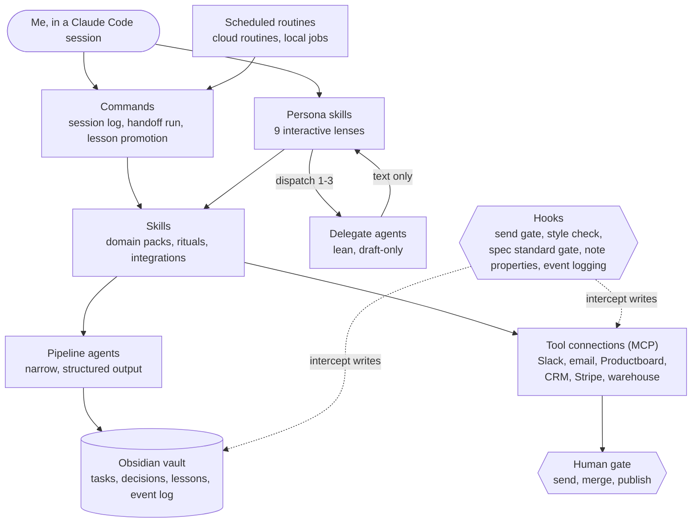
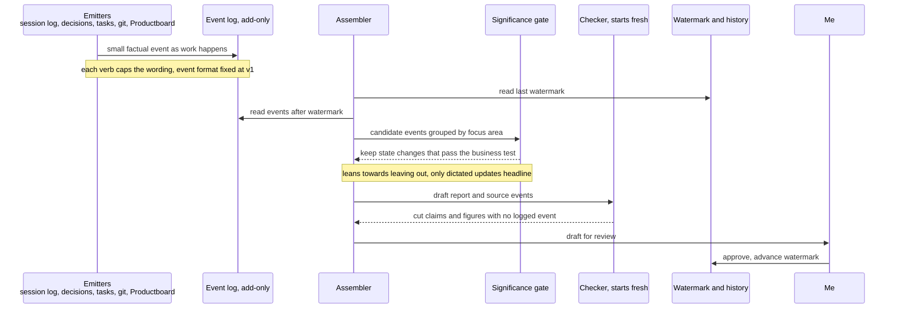
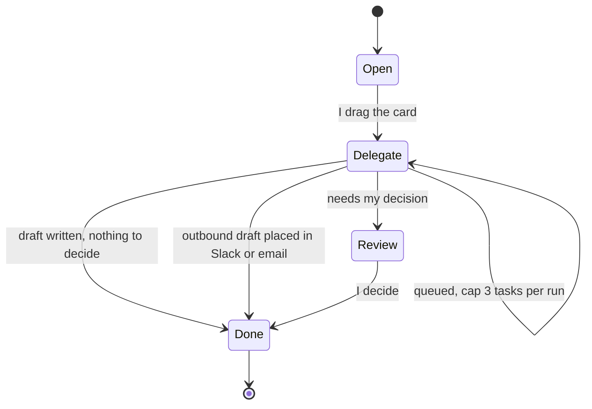
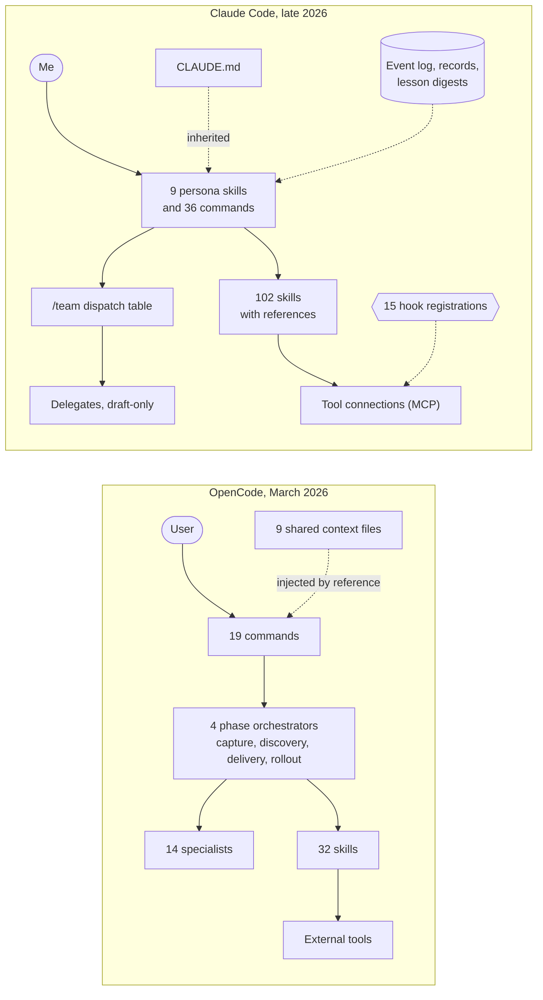

# Architecture

Four views of the agent OS as it stood in late 2026, plus the OpenCode design it replaced. Names are generic; the original files were private and were deleted at handover.

A few terms used throughout. Claude Code is Anthropic's AI assistant, which works with files and runs tools; OpenCode is an open-source assistant of the same kind that the system ran on first. A skill is a written procedure the assistant loads when needed. A subagent is a helper agent that runs a task in its own context and returns a result. A hook is a script that runs automatically before or after the assistant acts. MCP is the standard way the assistant connects to other software.

## 1. Layers

Commands and persona skills run in the main session, the conversation I am in. They dispatch delegates and pipeline agents, which return text or structured output and stop there, because a subagent cannot start another subagent. Skills hold the procedures and are the only layer that talks to outside systems through MCP. Hooks sit across every write: anything bound for Slack, email, a calendar or Productboard (the product roadmap tool) waits until I confirm the exact text, and outbound prose is style-checked first. Scheduled routines enter through the same commands I use by hand, so an unattended run follows the same rules as an attended one.

## 2. Weekly report built from an event log

The first version summarised daily notes and then summarised the summaries, and an audit found invented figures and inflated verbs. In this design each emitter (a small script attached to a source such as the session log or git) writes one short event at the moment work happens, and events are only ever added. The watermark marks the last point already reported. The assembler reads only the events after it, so past weeks cannot resurface. The significance gate asks two questions: did a real state change happen, and does it matter to the business. It leans towards leaving things out. Each event's verb caps how strongly the report may describe it, and a checker with no access to the drafting context strips anything that has no event behind it. After the first live run I added a source gate: mechanical events made up most of the draft, so only updates I had dictated may headline.

## 3. Agent handoff lane

The lane is two extra task statuses on the existing board. A runner fires three times each weekday, takes up to three Delegate tasks, routes each to one to three delegates through the `/team` dispatch table, and writes the primary delegate's combined draft onto the task. Until October every finished task went to Review, which held finished work, messages to send and real decisions together; 57 tasks built up there. After that change only decisions reach Review, and messages become drafts in Slack or email for me to send. Delegates never send anything themselves. Message tasks leaving the board after the draft is placed is my reading of the change; the exact status they took isn't recorded here.

## 4. OpenCode era against Claude Code era

The OpenCode design was a strict hierarchy. Commands went through the phase orchestrators (coordinating agents, one per phase of product work), and skills only ever called downward. It mapped the product operating model closely, and I had to add a consult mode so a command could get one specialist's view without running a whole phase. Moving to Claude Code removed the orchestrator layer. Personas became interactive skills that dispatch lean delegates directly. Shared context moved into one inherited `CLAUDE.md` (the instruction file the assistant reads at the start of every session) and skill references, and rules moved from prose into hooks. Memory moved from injected context files to records the system writes itself: the event log, decision and risk notes, and lesson digests.
