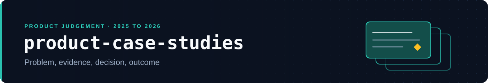

  

  <a href="../README.md">← Portfolio</a>

Product decisions from two former employers: a UK hospitality commerce company serving luxury hotels and spas, and before that a restaurant ordering and pay-at-table platform that belongs to a large UK software group. Each study has three parts: the problem and how I found it, the solution and how I chose it, and the impact, followed by what I'd do differently.

These are rewritten from my own notes. The original documents belong to those companies. Customers, partners and colleagues appear by role only, and commercial figures are given as shares and ratios rather than amounts. Where an outcome was still open at handover, the study says so.

## Measure before you claim

### [Retuning fraud rules that were turning away good guests](fraud-rules-blocking-good-guests/)

A fraud rule was declining genuine guests, some up to eight times. I narrowed it live against reversal triggers agreed in advance. Blocks fell by about 95%, recovered booking value outweighed the added fraud exposure by more than a thousand to one, and early fraud warnings did not rise. *Hospitality commerce, 2026.*

## Ship lean, then listen

### [An upsell engine operators would trust with their margins](upsell-engine/)

Restaurant operators rebuilt their upsell lists by hand every menu cycle. I chose a machine learning engine that learned pairings from real orders, then built the second release around pilot feedback: an audit trail and operator rules, because restaurants upsell for profit. Average transaction value rose 8% to 12% against control groups, and setup fell to under an hour per cycle. *Restaurant ordering, 2024.*

## More to come

Further studies on prioritisation, payments and integrations are being rewritten to the same standard and will be added here.

## Reading notes

- Time is given as elapsed time from the decision ("at six weeks"), not calendar dates.
- Diagrams are Mermaid and render on GitHub.
- Stripe and Productboard are named because the work is specific to them. Other vendors are described generically.
