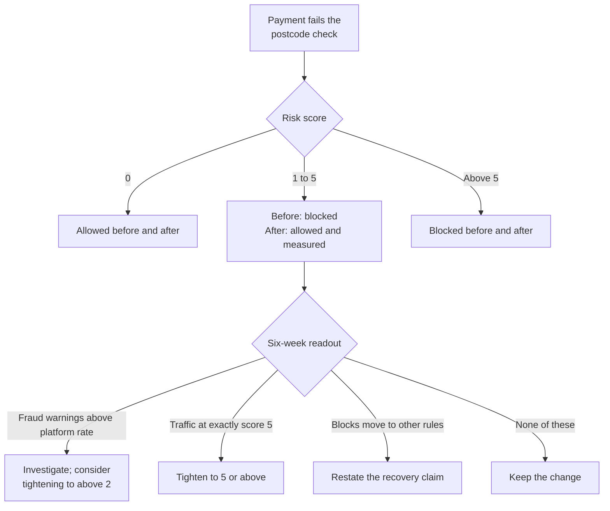

# Retuning fraud rules that were turning away good guests

| | |
|---|---|
| **Problem** | A fraud rule was declining genuine guests at checkout. Nearly two in five were declined repeatedly on the same booking, one of them eight times. |
| **Solution** | I narrowed the rule to high-risk payments, live, against a measurement plan with reversal triggers agreed before any results came in. |
| **Impact** | Postcode blocks fell by about 95%. Recovered booking value outweighed the added fraud exposure by more than a thousand to one. No rise in early fraud warnings at six weeks. |
| **What it shows** | Making a reversible call when no quick test can prove it safe, and measuring it honestly afterwards. |

**Where:** a UK hospitality commerce company (luxury hotels and spas), booking engine and voucher checkout on Stripe.
**When:** 2026, over about four months.
**My role:** product lead for payments and joint owner of the fraud rules. I made the rule changes and wrote the measurement plan.

## 1. The problem, and how I found it

### A spike in failed payments

I was checking a spike in failed payments. The spike itself was normal, but the check surfaced a standing problem: one fraud rule was the single largest cause of declined payments on the platform, ahead of insufficient funds, and it was firing 62% more often than a year earlier. Stripe Radar, Stripe's fraud screening, gives each card payment a risk score from 0 to 99 and applies rules the merchant writes. Ours blocked any payment whose billing postcode failed to match the bank's records if the risk score was above zero.

Genuine guests fail that check often: a house move, a company card, a typo. The blocks were spread across a wide range of properties. Guests saw a generic decline with no hint of what to fix, so they tried again: nearly two in five (38%) were declined more than once on the same booking, one of them eight times.

### Was the rule stopping fraud, or stopping guests?

A blocked payment is only a loss if the guest was genuine. I needed to know whether the people the rule caught carried real risk, so I asked three questions of the data:

- **Who did the rule hit?** 95% of the blocks scored 4 or below, where almost all genuine traffic sits.
- **Did those scores carry risk?** I built a dispute rate by risk score from a year of disputes (a dispute, or chargeback, is a cardholder asking their bank to reverse a payment). Scores 1 to 4 disputed at the same rate as score 0, within statistical error. Risk climbed steeply from 5 upward.
- **How many guests came back anyway?** Most did, but twelve months of data showed about two in five blocked bookings were lost for good. Any recovery claim had to discount the guests who would have paid anyway, or it would overstate the gain.

That settled the problem statement: the rule was blocking low-risk guests at the same dispute rate as payments it already allowed, and costing bookings and goodwill for no measurable fraud protection.

Payments that passed 3DS (the extra bank check some card payments need) were already allowed, so I left them out.

## 2. The solution, and how I chose it

### The constraint

Loosening the rule was expected to add only a marginal number of disputes a year, and disputes arrive 30 to 120 days after payment. No short trial could prove the change safe. Whatever I chose, the dispute verdict would arrive months later.

### Options I weighed

| Option | For | Against |
|---|---|---|
| Keep the rule; ask guests to check their postcode in the decline message | No added fraud exposure | Guests still blocked; helps only those who can spot the error |
| Review mode (a person approves each flagged payment) for 60 to 90 days | A clean comparison | A daily manual review queue with no agreed reviewer; a quarter spent relearning what the score analysis showed |
| Block only scores above 5, live, against a written measurement plan | Releases 85% to 95% of blocked bookings, depending on the period measured; reversible in minutes | No holdout (payments kept on the old rule for comparison); dispute safety unprovable for months |

### The decision

I chose the third option because it was the only one that stopped turning guests away, and it could be undone in minutes. The score analysis had already answered what a trial would have tested. The real risk was acting on that analysis without a way to notice if it was wrong.

So I changed the rule live to block only scores above 5, and before any results came in I wrote the measurement plan: checkpoints at two, four and six weeks, a dispute check at 60 days, and reversal triggers agreed in advance. The plan said plainly that zero disputes at six weeks was the expected result either way. The six-week risk read would rest on early fraud warnings, alerts card networks send within days or weeks of a suspect payment.

### Extending it to every rule

The six-week readout went to the business. It led with incremental recovered spend (gross, minus what guests would have recovered by retrying) and put the dispute caveat on the face of the page.

About a month after the change, I reviewed every rule with one added test: what share of blocked cards later paid successfully. The card security code (CVC) rule blocked any wrong code; 46% of its blocked cards later paid, and none showed fraud. That review led to four changes:

1. **Gate the CVC block on risk scores above 5.** This released nearly all the value of removing it and kept the few high-score blocks that carried most of the fraud exposure.
2. **Keep the postcode block and tighten it to 5 or above.** Removing it outright would have gained about as much in fees as it lost to fraud.
3. **Delete every rule already switched off**, so the rule list shows only what runs.
4. **Record joint ownership with the head of payments**, with a change log, a quarterly review and a reversal trigger per rule.

They went to the head of payments and two senior stakeholders as informed changes with a deadline to flag problems, since nobody held different data on the rules. All four went live about three months after the first change.

## 3. Impact

### Measured at six weeks

- **Blocks:** postcode blocks fell by about 95%, as planned, with no material shift to other rules.
- **Revenue:** recovered booking value, after discounting guests who would have paid anyway, came in well above the twelve-month model of lost value made before the change, and so did our fee revenue on it. It outweighed the modelled added fraud exposure by more than a thousand to one. Bookings the old rule would have blocked now make up about one in every hundred successful payments.
- **Guest experience:** repeat declines collapsed. A quarter of the guests still blocked were declined more than once, worst case four times, all at scores the rule exists to stop. Before: nearly two in five, worst case eight.
- **Risk:** no early fraud warnings on the newly allowed payments; the platform rate was flat against an equal period before.

### How the rules are run now

The fraud rules have named joint owners, a change log, a quarterly review and a reversal trigger for each rule, and the rule list shows only rules that run.

### Not yet known at handover

- **The dispute verdict.** No disputes so far on the newly allowed payments, which is expected while disputes are still arriving. The earliest payments reach full dispute maturity about six months after the change.
- **The second round of changes.** First read due six weeks after they went live.

## What I'd do differently

- **Give every pre-agreed trigger an owner and a date.** At four weeks, traffic appeared at exactly score 5, a trigger the plan named. The fix waited on a second round of alignment and only went live with the second round of changes. Exposure was small and showed no fraud, but an agreed trigger should not need agreeing twice.
- **Check every analysis before it reaches a decision or the business.** I ran much of the analysis with AI agents and checked their working each time. That caught three errors:
  - **A finding that turned the rule upside down.** The first cut showed payments that failed the postcode check disputed at a third of the rate of those that passed, which made the rule look backwards. It was Simpson's paradox, a pattern that reverses once you split the data by a hidden factor: almost all the failed payments had a risk score of 0, the safest group, while the passed group mixed every score. Split by score, the comparison fell apart: where the rule actually acted, there were too few disputes to show anything, and the case moved to the score analysis above.
  - **A four-week readout counted against a rule ID that Stripe had replaced** when the rule was edited, which overstated the fall in blocks.
  - **A zero-dispute result on a small slice** that briefly argued for leaving the rule in place, until a year of disputes by score band settled it.

  I'd build these checks into the measurement plan from day one: split every comparison by risk score, and confirm rule IDs before each readout.
- **Label gross and incremental from the start.** A gross figure reached the team stand-up as recoverable revenue and needed correcting later.
