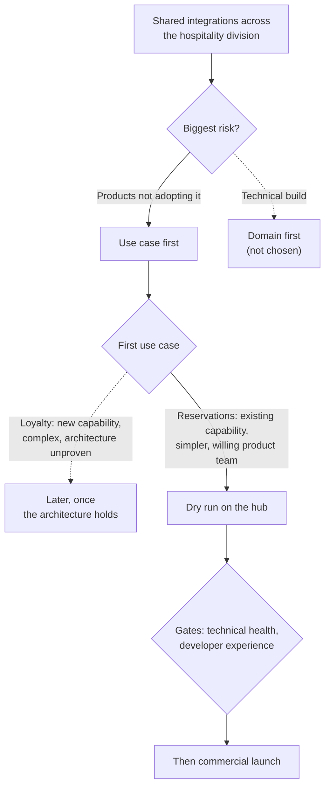
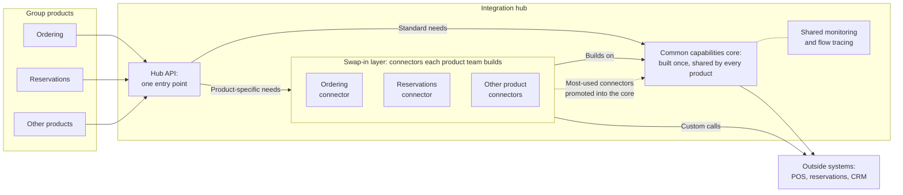

# An integration hub that products would choose to use

| | |
|---|---|
| **Problem** | A software group sold hospitality customers one connected suite, but each acquired product ran its own integrations, so customers still managed several vendors and cross-selling was hard. |
| **Solution** | A shared hub with common capabilities and swap-in connectors each product owns, proven first on a low-risk reservations use case before anything new was sold on it. |
| **Impact** | In about four and a half months, the architecture was demonstrated end to end on real integrations, and a contract barrier to sharing was caught before anything was sold on the hub. Adoption was open at handover. |
| **What it shows** | Naming adoption as the real risk, designing the platform around it, and holding the sequence (architecture first, commercial launch second) against pressure to sell sooner. |

**Where:** a restaurant ordering and payments platform, part of a large UK software group; this initiative served the group's whole hospitality division.
**When:** 2025, over about four and a half months.
**My role:** initiative lead. I led a dedicated engineering squad, ran discovery, set the scope and the success measure, and chose the first use case and first adopting product, agreed with the programme sponsors and commercial leadership.

## 1. The problem, and how I found it

### One suite on paper, several vendors in practice

The group grew by acquisition. In one year it bought several hospitality software companies, ours among them, to offer customers a suite of products. Each company arrived with its own integrations: the connections to outside systems such as point of sale (POS, the till system), reservations, customer relationship management (CRM) and loyalty. Each stack was built before the group's wider plan existed, and staying on it was the cheapest course for each company.

The cost landed on the group. It sold customers one point of integration, but customers still managed a separate vendor for each product, and the products connected to their systems in different ways. That made cross-selling hard.

Our company relied on outside integrations more than any other in the division, and already solved this problem for itself. We ran an aggregation service: one common interface for all our ordering channels, covering menus, orders and stock availability, with a module for each of more than a dozen till systems. I was asked to lead a squad to build the group-wide version.

### What the integrations had in common, and what they didn't

To find where the cost sat, I surveyed product engineering teams across the division and, with an analyst, built a registry of every integration they ran. Three findings shaped the initiative brief I wrote:

- **Every surveyed team was rebuilding integrations that already existed elsewhere in the group.** Integration-heavy teams reported spending up to half their development capacity on it, and estimated six to eight weeks per integration. Teams with little capacity could not build the integrations their customers asked for at all.
- **Teams reported the same vendor's integration ranging from highly reliable to failing daily** from product to product, watched through a spread of separate monitoring tools.
- **Each product needed something different from the same system.** My working hypothesis was that integrations differed because each business needed different things from them. It held: the group's reservations product made very different calls to the same till system than our ordering product did.

A fourth came out of an early demo conversation and was confirmed with commercial leadership: existing partner contracts could block sharing an integration across products. One barred access for a named competitor.

The problem statement: the group could not deliver the single suite it sold until its products could share integrations, and any shared layer had to let each product keep doing what it needed without the platform team dictating how.

## 2. The solution, and how I chose it

### The constraint

The squad could not become the support desk for every engineering team in the division. Product teams also had to stay accountable for the security and uptime of their own products. A hub that forced every product onto one way of integrating would fail on both counts.

### Options I weighed

| Option | For | Against |
|---|---|---|
| Domain first: a common model for each type of system, starting with POS, then add vendors | Proven at our company; scales well once mature | Long before any product uses it; risks building a model nobody adopts |
| Use case first, loyalty: a new capability the group could sell | High value; backed by commercial leadership | Far more complex; puts a sellable capability on an architecture not yet proven |
| Use case first, reservations: an existing capability moved onto the hub | Simpler; a low-visibility dry run; a willing first product | Moves a working integration, against our own rule that new integrations come first; tests one product's needs; leans on one engineer's knowledge |

### The decision

I put the question of domain or use case to the sponsors and architects. We agreed the biggest risk was products not using the hub, ahead of any technical risk. That settled use case first: a real product on the platform early would test the model and build the case for further investment.

Commercial leadership pushed for loyalty. I chose reservations. Loyalty would have unlocked a new capability to sell while the underlying technology was still unproven, and it is far more complex than table reservations. I wanted the first use case to be a dry run, so the architecture was validated before any commercial launch rested on it. Commercial leadership agreed.

I chose the reservations team as the first adopting product. Most teams liked the idea but were committed beyond their capacity and could not act as test customers. The reservations team was keen to help, and one of our engineers had built most of their integration stack.

The architecture would count as validated on two gates. First, technical health: the hub moving data reliably against the stability baseline in the brief. Second, developer experience: was it simple to integrate with, and could product engineers get and send the information they needed?

### The design: common capabilities, swap-in connectors

The hub provides the base capabilities every product needs. Each product team builds and maintains its own connectors, which run inside the hub. A connector builds on the common capabilities and can also call an outside system directly for what that product specifically needs. Products keep their own store configuration and credentials. The squad never had to triage customisation requests from every team, and each product team stayed responsible for its own security and uptime.

The core was designed to grow from use. The connectors products swap in show which capabilities are popular, much like community-voted modules, and the most used would be absorbed into the common set, shortening integration for the next acquisition.

### Making invisible work visible

Integration aggregation does its job when nobody notices it, and our audience ranged from engineers to commercial leaders. So we built a visualisation layer: individual order and call flows traced from start to finish, with performance statistics for each integration. Early programme reviews had shown that live demos landed far better than demos on a local machine, so we built it on real code and APIs (application programming interfaces, the way one system requests data from another).

## 3. Impact

### Measured at handover: delivered, not yet adopted

- **Architecture proven in development:** live requests to several outside reservation systems were translated into one common format and routed through a shared gateway, a single entry point that handles authentication and request limits. Deployment was not yet complete.
- **Risk caught early:** the contract barrier surfaced before anything was sold on the hub. I started a standard framework for new partner agreements with commercial leadership; it was still in draft at handover.
- **Early, visible proof:** six to eight weeks in, I demonstrated the dashboard and flow tracing to the programme steering group, showing an integration created and extended for a specific product.
- **A template for what comes next:** a reference project, the starter codebase future services copy, set the architecture for later domains such as loyalty and online ordering.

### Not yet known at handover

- **Adoption.** I set voluntary adoption as the success measure. I handed the initiative to the lead engineer before any product used the hub in production, and I don't know how adoption went after that.
- **The gates.** Neither validation gate had been formally assessed.

## What I'd do differently

- **Start the commercial review in week one.** Partner contracts limited what the hub could share as much as the code did. I learned it from a demo conversation weeks in; it belonged in discovery.
- **Prove the path to production first.** We planned to demo from a deployed environment, and cloud permissions blocked that; they were still blocking automated deployment at handover. A short test of the route to production at the start would have surfaced it in time.
- **Make the developer-experience gate measurable.** I'd track time to first call (how long a new developer takes to make a first successful request) and run a short satisfaction survey after each integration, so the gate rests on numbers.
