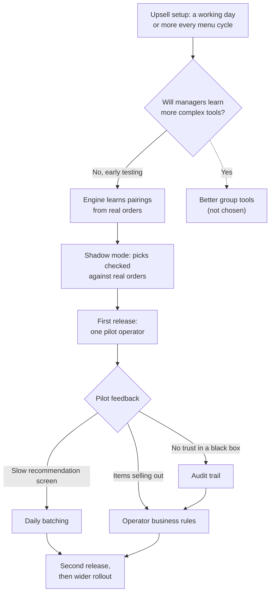
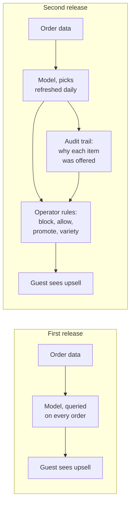

# An upsell engine operators would trust with their margins

| | |
|---|---|
| **Problem** | Restaurant operators rebuilt their upsell lists by hand every menu cycle, a working day or more each time, because each list fitted only the items it was built for. |
| **Solution** | A machine learning engine that picks upsells from real orders. The second release added an audit trail, operator business rules and daily batching, in response to pilot feedback. |
| **Impact** | On wider rollout, average transaction value rose 8% to 12% against control groups within the same operators, where the plan had only asked it to hold steady. Upsell setup fell to under an hour per cycle. |
| **What it shows** | Shipping a lean first release to test the direction, then reading the feedback the numbers missed and building the next release around how operators make money. |

**Where:** a restaurant ordering and payments platform, part of a large UK software group; kiosk, mobile and online ordering for quick-service and enterprise restaurant operators.
**When:** 2024, over about a year.
**My role:** product lead for ordering. I was accountable for value and viability: I chose what to build, set the investment and the success measures, and reported progress to the business. Engineering owned feasibility and design owned the guest and operator experience.

## 1. The problem, and how I found it

### The same request from every kind of operator

When we asked operators where we could improve, one answer kept coming back: upsell setup took too long. It came from smaller kiosk and mobile operators and from our largest enterprise clients alike. No deadline was attached, but demand was high across every segment, so I looked at how the work was done.

Our menus had carried upsells and optional extras since the first version of the menu builder. To set one up, a menu manager created a group, added the upsell items to it, then attached the group to each item, combo or meal it should appear against: extra bacon on a burger, for example.

### Why the work kept coming back

I asked three questions of the setup work.

- **Could a group be reused?** Rarely. Extra bacon belongs on a burger and is wrong on a pasta salad. Extra croutons make no sense on a salad that already has them. Managers built many near-identical groups, some differing by one item, some by most of them.
- **How often did the work recur?** Quick-service restaurants (QSRs, the fast-food and fast-casual chains) keep a base menu for about a year and run limited-time offers (LTOs) alongside it. LTOs make up as much as a fifth of the menu and change every six to eight weeks. Each change meant building new groups or attaching existing ones to the new items, against the tight deadlines LTOs run to.
- **What did it cost?** Upsell setup took 8 to 15 hours per LTO cycle. There was upkeep on top: items in the groups changed stock codes (SKUs, the product codes in the till system) whenever a supplier changed.

The problem statement: upsell setup was a recurring tax of a working day or more on every menu cycle, paid by managers with little time to spare, and the structure of the groups meant the tax could only grow with the menu.

## 2. The solution, and how I chose it

### The constraint

Operators wanted the time back. Early testing showed something just as important: revenue and restaurant managers had neither the time nor the appetite to learn anything more complex. Any answer had to make menu management simpler for them.

### Options I weighed

| Option | For | Against |
|---|---|---|
| Keep hand-built groups as they are | No build; operators keep full control | The tax grows with every LTO cycle |
| Better tools for managing groups, including bulk editing | Familiar model; operators keep full control | Adds complexity managers had shown they would not learn; still manual every cycle |
| An engine that picks upsells from real order data | Removes the setup work; learns what guests actually buy together | Unproven; operators hand over a revenue decision; it could learn the old groups back or make poor picks |

### The decision

I chose the engine, because it was the only option that removed the work. Better tools would have made a manual job faster and the menu builder harder to use, which the testing had ruled out.

The model learned which items guests bought together in real orders. Existing upsell groups already shaped those orders, so the team corrected for that bias, or the engine would have learned our old configuration back. Before any guest saw it, the engine ran in shadow mode for several weeks: making its picks in the background, with nothing shown, so we could check them against real orders. Then the first release went live with one pilot operator.

### What the pilot showed

Average transaction value rose almost immediately. The feedback raised three problems.

1. **Speed.** The engine was queried live while each guest built a basket, which slowed the recommendation screen.
2. **Stock.** The engine promoted items the restaurant usually sold few of. Shown prominently, they sold out. With those gone, the engine drew on a narrower set of upsells and sold through those faster too. Pilot sites ran out of items often.
3. **Trust.** Revenue and marketing managers called it a black box and did not trust its picks.

The third problem held the lesson. We had built almost exactly what operators asked for, and they found it lacking. Restaurants upsell to raise profit, and average spend is only part of that: a large portion of fries is offered with a meal because of the margin on the larger size. Operators had business rules behind every upsell, and those rules were theirs to set.

So I put the second release into opening the black box. Showing better results would not have won trust on its own; operators needed to see why each item was offered.

### What the second release changed

- **An audit trail.** Operators could look back at any recommendation and see how the engine reached it.
- **Business rules to act on it.** Operators could block items, allow only chosen items, promote high-margin items and set how much variety the engine could use. Several kept it tightly locked down, and could. The rules also ended the stock problem: operators could keep the engine away from items they could not hold in stock.
- **Operators planned for the knock-on effects.** Pilot restaurants had not expected an upsell engine to change what they needed to stock. Once they saw it, they built the engine's effect into their ordering and inventory planning.
- **Daily batching.** The engine worked out pairings for the most popular items once a day, and the ordering platform served them from its own services. A busy site no longer asked the model what goes best with a cheeseburger on every cheeseburger order, and ordering speed returned to normal.

## 3. Impact

### Measured on wider rollout

These figures come from the wider rollout and were shared with me by a former colleague.

- **Revenue:** average transaction value rose 8% to 12% against control groups (comparable orders at the same operators without the engine's picks). The plan had treated stable transaction value as the guardrail, so this beat it.
- **Time:** upsell setup fell from a working day or more per cycle to under an hour.
- **Guest experience:** ordering speed returned to normal once picks were batched daily.

### A new tool for revenue managers

The engine became an experimentation tool. From its results under their own rules, revenue managers could see quickly how well an item sold as an upsell. Strong performers could move into the permanent menu, and weak ones could be spotted and cut at very little risk or cost.

### Not yet known at handover

- **Margin.** The measures were time and transaction value; the effect on margin per order is not in my record.

## What I'd do differently

- **Plan for transparency from the start.** We had good reason to expect a black box would struggle with revenue managers, and could have planned the audit trail earlier. I'd weigh that against speed: the first release was there to test whether automated upsells were the right direction at all, and a lean version answered that quickly. Next time I'd ship the lean version with the audit trail designed and ready to follow.
- **Measure what operators optimise for.** I'd set margin per order beside transaction value as a success measure from day one, since profit is why restaurants upsell.
